# U3 数据模型评审：单用户 → 多租户的共享 / 私有边界

> 评审对象：`/root/DSH/应用/ssqyuce`（Python 3.13.5 + FastAPI + SQLite 3.46.1，单节点、`data/` 为唯一数据副本）
> 评审方式：**只读**。本文所有 schema、行数、pragma、代码行号均为本次对生产库与源码的实测结果；
> 未修改 `data/ssq.db`、未修改任何业务代码、未执行任何写库语句（所有 DB 访问均用 `file:...?mode=ro` 只读连接）。
> 交付物：本文件（唯一写入）。
> 关联文档：`U1_IDENTITY.md`（users 表设计，本文引用）、`U2_LLM_ISOLATION.md`（user_llm_config，本文引用）、`V13_LEAD_VERDICT.md`、`M2_STATISTICS.md`（多重检验治理）。

### 修订记录（Lead 裁决已全部落地）

| 裁决 | 内容 | 落点 |
|---|---|---|
| 1 | **作废「`user_id=1` 保留给 admin」**；admin 用 `username`+`role` 动态定位；新增列 `DEFAULT 0`（=SYSTEM） | §0-C2/C7、§2.3、§3.2、§3.3、§3.4、§3.7、§6.2、§5.10、§7.2、§7.5、§7.7、§9.1、§12-1 |
| 2 | 软删除保留，**补三条硬约束**（session 立即失效 / 成本归属不消失 / GDPR 显式事务删除，不靠 CASCADE） | §12-3 |
| 3 | **FK CASCADE 降级为冗余防御**；正确性来源 = 应用层显式删除；补不依赖 PRAGMA 的孤儿行测试 | §3.6、§12-5、§12-11 |
| 4 | **bootstrap admin 零权限**：`status='bootstrap'` 期间所有鉴权拒绝，只能走一次性 env token；设密成功后才 `active` | §7.2（迁移 5）、§12-2、§7.7 |
| 5 | **`config_fp` 只在同一用户内比较**；缓存键必须是 `(user_id, issue, config_fp)` 三元组 | §4.6（纪律 2）、§12-6 |

> 另：应 Lead 要求，测试影响已给出**逐文件逐行号清单**（§8.7），U4 可直接用于排期。

---

## 0. 结论摘要（先看这 8 条）

| # | 结论 | 影响面 |
|---|---|---|
| **C1** | 数据边界不是「DB 表 vs JSON 文件」，而是**「世界的事实 / 用户的决策 / 谁的账」三条判据**。按此判据：14 张现有表里 **6 张全局共享、7 张每用户私有、1 张基础设施**，另有 5 张表被判为「混合」并给出拆分方式（§2）。 | 决定后续所有 DDL |
| **C2** | `predictions` 必须改主键为 `(user_id, issue, seq)`，历史 40 行（7 期：2026114 十注，2026115–2026120 各五注）全部回填给 `admin`（**admin 按 `username`+`role` 动态解析，禁止写死 id=1**——AUTOINCREMENT 不复用 ID，删后重建会得 2）。SQLite 改主键**只能整表重建**，本项目的迁移框架（`migrations.py`）**能**把重建包进同一事务，且**会**自动先备份（§3.2/§3.3 已逐条核实）。 | 核心迁移 |
| **C3** | **推荐方案 C：事实层共享 + 决策层按用户 + 账本按用户。** 理由**不是省钱**（实测 37 次调用共 2.7249 元、单次 0.0736 元、外推 10 用户 ≈ 230 元/年，成本根本不是约束），而是：**方案 B 会让「每用户 LLM 配置」变成不可观测的装饰功能**——用户配了自己的 key，却拿到别人生成的结果，需求自相矛盾（§4）。 | **决定产品形态** |
| **C4** | 顺带发现一个**今天就存在、多用户后变成跨租户事故**的缺陷：`/api/predict` 的缓存命中判据只有 `issue`，**不含请求参数**（`n_tickets`/`bet_mode`/`coverage`）与 LLM 配置。今天表现为「后到的请求参数被静默忽略」，多用户后表现为「A 的票被当成 B 的票返回」（§4.2）。 | 必须在 v5 一起修 |
| **C5** | **前置注册簿（α 台账）必须全局，但必须可归因**。关键论点：**校正的分母是"共享的 3516 期数据被检视了多少次"，不是"谁点了按钮"**。若按用户各自 α，则 N 个用户各跑一族检验、结果汇入同一个共享规律库时，库的 FWER = `1-(1-α)^N`（N=10、α=0.05 时 **40%**），这正是「规律库变噪声库」。正确解法是「全局台账 + `by_user` 归因 + 全局发布规则 + 私有草稿命名空间」（§5）。 | 直接决定「挖/验/用」形态 |
| **C6** | `tasks` 表加 `user_id`；**`/api/tasks/{task_id}` 必须校验归属**，因为 `task_id` 只有 32 bit 随机（`uuid4().hex[:8]`），而 `result_json` 里装着别人的票单——这是新增的 IDOR 面（§6）。 | 安全 |
| **C7** | **迁移无法"分批灰度"**：框架把**所有 pending 迁移放在同一个事务**里跑（`migrations.py:263-293`），发一次代码 = 5→8 一步到位。所以灰度只能做在**行为层**：schema 一次把列加齐且全部带 `DEFAULT 0`（= `SYSTEM_USER_ID`；老代码不写 `user_id` 时落到"系统/历史"语义，**不是**落到某个具体人头上），再用 `LOTT_MULTIUSER` 开关切换读写语义（§7）。另：U2 文档写的"batch-5"会与 U1 的 users 迁移撞号，占号必须以 §7.1 为准。 | 上线策略 |
| **C8** | 1057 个收集用例（1036 通过）里，**真正会红的只有 3 个文件 9 处 `lambda`**（`load_predictions` 被 monkeypatch 成单参函数 → `TypeError`），**另有 8 个文件 23 处直接调用在推荐签名下零改动**。完整「文件名 + 行号」清单见 **§8.7**（U4 可直接拿去排期）。 | 交付成本 |

---

## 1. 现状取证（只读实测）

### 1.1 表清单与行数

实测命令见附录 A。与 Lead 提供的硬事实一致，另补 3 个 Lead 未列的事实：

| 表 | 行数 | 主键 | 有 user 维度 | 备注（本次新增实测） |
|---|---:|---|---|---|
| `draws` | 3516 | `issue` TEXT | ✗ | 外部事实 |
| `features` | 8 | `issue` | ✗ | 仅最近 8 期，**是缓存不是事实** |
| `patterns` | 47 | `key` | ✗ | 8 个 B 级 + 39 个 C 级；kind: long 3 / mid 18 / short 26 |
| `predictions` | 40 | `(issue, seq)` | ✗ | **7 期**：2026114(10 注) + 2026115–120(各 5 注) |
| `eval_results` | 6 | `issue` | ✗ | 组合级（一行=该期全部方法合计） |
| `eval_meta` | 28 | `(issue, method)` | ✗ | `method` 里**内嵌模型名**（见 1.2） |
| `eval_details` | 35 | `(issue, method, seq)` | ✗ | 同上 |
| `tasks` | 6 | `id` TEXT | ✗ | **含 2 条测试残留**（`t_8b0cd671`/`t_e40b4d9a`） |
| `llm_audit` | 0 | `audit_id` | ✗ | 已建表未启用 |
| `llm_eval_results` | 0 | `id` 自增 | ✗ | 离线评估 |
| `mining_runs` | 0 | `id` 自增 | ✗ | 挖掘运行记录 |
| `replay_results` | 0 | `(method, mode, issue)` | ✗ | walk-forward 回放 |
| `reconcile_runs` | 0 | `id` 自增 | ✗ | 多源对账 |
| `schema_version` | 4 | `version` | — | 1..4，当前 **4** |
| `sqlite_sequence` | 0 | — | — | 内部表，**当前为空**（重要，见 3.3） |

### 1.2 `eval_*` 的 method 列里内嵌了 LLM 模型名（决定分类的关键证据）

```
eval_details.method 实测分布：
  llm:agent-router/deepseek-v4-flash            24
  llm:group/auto-deepseek-v4-flash-vision        4
  ml 2 / stat:bayes 1 / stat:freq 2 / stat:markov 1 / stat:omission 1
eval_meta.method 实测分布：
  llm:agent-router/deepseek-v4-flash 6 / llm:group/auto-… 1 / ml 2 /
  stat:bayes 4 / stat:freq 3 / stat:markov 4 / stat:omission 3 / uniform 4 / blend:blue_compound 1
```

**这条证据直接推翻「eval_\* 可以全局共享」的直觉**：`method` 字符串是用户 LLM 配置的投影。
多用户后，两个用户可能产生**相同的 method 字符串**（同一模型不同 key → 主键 `(issue, method)` 直接冲突，
后写者 `INSERT OR REPLACE` 覆盖先写者），也可能产生**不同的 method 字符串**（不同模型 →
所有人的票混进一张"方法战绩表"，ROI 与命中率失去共同分母）。两种情况都是数据串号。

### 1.3 存储形态全景：多租户不只是改 DB

`data/` 共 **222 MB**（实测），除 DB 外还有 13 类运行时状态文件。多租户若只改 DB，等于只做了一半：

| 文件 | 大小 | 内容实测 | 归属判定 |
|---|---:|---|---|
| `hypotheses.json` | 57 KB | 33 条假设（**20 条 LLM 产出** / 13 条 stat），32 proposed + 1 rejected；`prereg_ok` 字段**全部缺失**；`counters.n_tested_cumulative = 0`、`batches = []` | 全局台账 + 每条带 owner（§5） |
| `patterns_runtime.json` | 21 KB | 21 条规则，**usable = 0**，全部 `monitor`；`scan.n_tested=124`，`expected_false_positives=6.2` | 全局快照（事实） |
| `rule_lifecycle.json` | 335 B | `rules={}`、`judgements=[]`（生命周期尚未跑过） | 全局（规律的属性，非用户的属性） |
| `llm_budget.json` | 73 B | **1 个键**：`https://magpie.ivyxy.com/v1\|agent-router/deepseek-v4-flash: 32000` | **注意：这不是"钱"预算，是「该模型可行的 max_tokens 学习值」**（`llm_client.py:349-408`）。建议按用户存（写入者带全局缓存，见 §2.4） |
| `llm_cost_log.jsonl` | 10 KB | 37 行；字段 `ts/model/purpose/tokens/yuan/ok/attempts`，**无 user 字段**；合计 **2.7249 元**，成功 27 / 失败 10（**失败率 27%**） | 混合：**单文件追加 + 每行加 `user_id`**（迁移成本最低） |
| `llm_config.json` | 208 B | 全局 LLM 配置（含 API Key，权限 600） | → `user_llm_config`（U2） |
| `llm_claims.json` | 5.7 KB | `claims=[]`、`runs=4` | 每用户（消耗谁的预算） |
| `evolution_state.json` | 207 B | `last_fingerprint="3516:2026119"` | 全局（去重指纹） |
| `adaptive_state.json` | 2 B | `{}` | 全局 |
| `mining_artifact.json` / `mining_latest.json` | 129 KB / 824 B | run_id `mine_20260821_163404`，12 候选 / 3 接受 | 全局（共享数据的挖掘产出） |
| `ml_models/*.joblib` | ~265 MB | 4 个模型（含 `v2:` 前缀版本） | 全局（可由训练重建） |
| `raw/*.txt` | 12 个 | 开奖原始快照 | 全局（事实） |

### 1.4 连接层与 pragma 事实（全部只读实测）

```sql
-- PRAGMA 实测（journal_mode 等为持久属性，来自库文件本身）
journal_mode = delete      -- 未启用 WAL
foreign_keys = 0           -- 从未启用外键约束
synchronous  = 2 (FULL)
busy_timeout = 5000
legacy_alter_table = 0
user_version = 0
sqlite_version = 3.46.1
views = []  triggers = []  -- 无视图、无触发器（RENAME 的坑因此小很多）
```

代码侧：

* `db.py:160` `_CONN` 单全局连接；`db.py:163-174` `get_conn()` 首次连接时 `executescript(SCHEMA)` → `migrations.apply()` → `_ensure_columns()`。
* 连接**无锁**、`check_same_thread=False`、79 个同步端点跑线程池 → 多线程共享**同一个** `sqlite3.Connection`。
* `migrations.py:117-124` 迁移列表 4 条，全部 forward-only；`migrations.py:296-321` `apply()`；`migrations.py:263-293` 批次事务。

### 1.5 读写面在哪里（迁移改动面清单）

`predictions` 的 SQL 只出现在 **6 处 `db.py` + 1 处 `api_app.py`**（好消息：改造成本可控）：

| 位置 | 作用 | 多租户后必须改 |
|---|---|---|
| `db.py:353-369 save_predictions` | `DELETE FROM predictions WHERE issue=?` + 逐注 INSERT | ✅ **最危险**：不按 user 收敛 = 删别人的票 |
| `db.py:372-384 load_predictions` | `WHERE issue=?` | ✅ |
| `db.py:387-396 _recent_prediction_issues` | `GROUP BY issue` 取最新 | ✅ |
| `db.py:407-416 load_last_predictions` | 全站「最近一期」 | ✅ |
| `db.py:419-428 recent_prediction_issues` | 历史列表 | ✅ |
| `api_app.py:398-404`（`/api/predictions/last`） | **内联裸 SQL**（不受 db 层封装） | ✅ 容易被漏 |
| `api_app.py:294`（`/api/predict` 缓存命中） | `db.load_predictions(issue)` | ✅（且判据要加 config_fp，见 §4） |

`tasks` 的 SQL 在 `db.py:694-753` 六个函数 + `api_app.py:2847` 一处内联 UPDATE。
`eval_*` 的 SQL 在 `db.py:433-514`、`db.py:646-662` + `evaluate.py:236-258 online_check()`。

---
## 2. 判定原则与逐表分类

### 2.1 三条判据（不是「一刀切」）

判定一张表/文件归谁，我按**顺序**问三个问题，任一命中即定：

1. **可复现性判据**：该内容是「给定共享输入（`draws`）的确定性函数」吗？
   是 → **全局**。理由：确定性函数对任何用户都算出同一个值，按用户存 N 份是 N 份同一个数，
   只会制造「同一期不同用户看到不同基线」的不一致。
2. **世界事实 vs 用户决策判据**（Lead 给的判据，我采用并精确化）：
   * **世界的事实** = 不因"谁来看"而改变。开奖号、特征、规律、挖掘产出、离线回放、数据源对账。
   * **用户的决策** = 只有"这个人"才能产生，且换个人就该是另一份。票单、票数/玩法/覆盖模式、评估战绩、任务、LLM 调用与预算。
   → 事实全局，决策私有。
3. **账本判据**：该行数据是否**花掉了某个人的钱/配额**，或**其数值只在"同一个人的票"内部才有意义**？
   是 → **私有**，哪怕内容是"客观结论"。
   典型：`eval_details` 逐注命中是客观的（判据 2 会说可共享），但**ROI 的分母是该用户的投注额**
   （判据 3 判私有）。**判据 3 优先于判据 2。**

**判据 3 优先**这一条很重要，它解释了为什么 `eval_*` 必须私有——这是本设计最容易被拍错的一张表。

### 2.2 逐表判定（14 张现有表）

| 表 | 判定 | 论证（判据编号） | v5 动作 |
|---|---|---|---|
| `draws` | **全局共享** | (1)(2) 外部世界的事实，任何用户都无法产生或改变；3516 期是全体用户的共同输入。若按用户存，等于把同一份公开数据抄 N 份且必然不一致。 | 不动 |
| `features` | **全局共享（缓存）** | (1) 是 `draws` 的确定性函数；(2) 无任何用户输入。8 行只是"最近 8 期"的缓存，删了能重算。 | 不动 |
| `patterns` | **全局共享** | (1)(2) 47 条是"数据集本身的统计性质"（长期/中期/短期规律），换用户不会变；`mined_%` 来自对共享数据的挖掘。**规律是世界的假设，不是用户的私产**（§5 展开）。 | 不动（可选加 `owner_user_id`） |
| `predictions` | **每用户私有** | (2)(3) 票单是用户的决策产物，且每注 2 元是**该用户**的钱。同一期不同用户就该有不同票。 | ✅ 重建主键（§3） |
| `eval_results` | **每用户私有** | (3) 一行 = 该期该用户所有注的合计；`roi` 的分母是该用户的投注额。全局化后 ROI 变成"所有人的钱混在一起"，无法归因。 | ✅ 加 `user_id` 进主键 |
| `eval_meta` | **每用户私有** | (2)(3) 存的**是用户当时的配置快照**（`config_snapshot_json` 里含 `method_mode`/`llm_only_output`/`bet_mode`/`coverage_mode`），换用户就该是另一份；且 `method` 内嵌模型名（§1.2），主键 `(issue, method)` 在多用户下**必然冲突**。 | ✅ 主键 → `(user_id, issue, method)` |
| `eval_details` | **每用户私有** | (1) 逐注命中确实只由票+开奖决定，但 (3) 它的存在意义是"这个人的方法战绩"；全局化后 `cumulative_eval()`、`method_recommendations()` 的配对检验会拿不同用户的票做配对 → 统计口径直接错。 | ✅ 主键 → `(user_id, issue, method, seq)` |
| `tasks` | **每用户私有**（+ 系统任务） | (2)(3) 后台任务是"谁的请求"；`result_json` 里装着该任务的产出（可能含票单）。 | ✅ 加 `user_id`（§6） |
| `llm_audit` | **混合** → 存私有、可全局聚合 | (2) `input_json`/`output_json` 是用户票单与 LLM 往返（私有）；但 `verdict`/`fail_fields` 是**对输出的客观判定**（可全局）。**拆分方式**：行留在私有域按 user 过滤；另出一条"审计结论统计"的聚合视图（按 `post`/`verdict` 分组计数，不含输入输出）。 | ✅ 加 `user_id`（表当前 0 行，零迁移成本） |
| `llm_eval_results` | **混合** → 存私有、结论可发布 | (3) 一次 `window_issues=60` 的 LLM 评估会烧**发起者**的预算；(2) 但结论（该方法相对随机的 lift）是共享事实。**拆分方式**：行带 `user_id`（谁付费谁拥有）；对外展示时标注"由 <user> 发起，样本 N"，不合并成"系统结论"。 | ✅ 加 `user_id`（0 行，零成本） |
| `mining_runs` | **全局共享** | (1)(2) 对共享 3516 期的挖掘运行记录；挖掘本身不消耗用户 LLM 预算（`engine=lightgbm/rf/lift`）。 | 不动 |
| `replay_results` | **全局共享** | (1)(2) walk-forward 回放在共享 draws 上跑，与用户无关；`method` 来自全局方法配置。**若将来允许用户自选方法集**，则需加 `config_fp` 而非 `user_id`（同配置可共享结果）。 | 不动 |
| `reconcile_runs` | **全局共享** | (2) 数据源对账是**数据的可信度审计**，是所有人的前置条件。 | 不动 |
| `schema_version` | **基础设施** | 与租户无关。 | 不动 |

### 2.3 新增表（本文负责的部分）

| 表 | 归属 | 理由 |
|---|---|---|
| `users` | 全局基础设施 | **U1 负责设计**，本文只引用：`user_id INTEGER PRIMARY KEY AUTOINCREMENT`、`username TEXT UNIQUE`、`role TEXT CHECK(role IN ('admin','user'))`。本文额外要求（**Lead 裁决，硬约束**）：**禁止在任何 SQL / 代码里写死 `user_id = 1`**——admin 一律用 `username` + `role` **动态定位**。理由：`AUTOINCREMENT` **不复用 ID**（实测：删光用户后重新插入得到 `user_id = 2`，不是 1）。只要生产上发生过一次"建 admin → 删 → 重建"，写死 1 就会**静默指向错误的人**（= 静默越权）。详见 §3.4。 |
| `user_llm_config` | 每用户私有 | **U2 负责设计**，本文只在 ER 图里画 `user_id → users.user_id` 外键关系，不重复设计。 |
| `issue_baseline`（建议新增） | **全局共享** | 方案 C 的落点：把「L0 事实层」按 `(issue, config_fp)` 缓存，供所有用户复用，保证**同一期所有人看到同一条基线**（§4.6）。也可复用 `features`，但其 PK 是 `issue` 且 payload 语义是"统计特征"，塞入指纹需要二次重建，**新表更便宜**。 |
| `user_llm_budget`（建议 U2 采纳） | 每用户私有 | 现 `llm_budget.json` 是**按 `(base_url, model)` 学习 max_tokens** 的全局文件 + 全局内存缓存（`llm_client.py:344-346`）。多用户后同一 URL 可能被不同用户的不同 key 使用，学习值应带 user 维度，否则 A 学到的 32000 会让 B 从 32000 起步（污染）。**若 U2 决定保留全局**，须在文档里写明"该值是模型行为、不是用户偏好"，并保证只增不减、无隐私泄漏。 |
| `hypotheses`（建议 P2，不进 v5） | 全局台账 + `owner_user_id` | 现真源是 `data/hypotheses.json`（33 条）。**本阶段保留 JSON**（单写者、原子替换、`test_v10_registry.py` 15 个用例强依赖文件语义），但每条记录加 `owner_user_id`/`visibility`；DB 化列为 P2（§5.6 给 DDL）。 |

### 2.4 反例：把 `eval_*` 做成全局会发生什么（为什么必须拆开）

这不是理论推演，用现有数据就能算出来：

1. **主键冲突 → 静默覆盖。** `eval_meta` PK 是 `(issue, method)`，`save_eval_meta()` 用 `INSERT OR REPLACE`（`db.py:443`）。
   用户 A、B 都用 `llm:agent-router/deepseek-v4-flash` 出号 → 同一 `(issue, method)` → **B 的写入静默覆盖 A 的配置快照**，
   A 的历史"当时用的什么配置"永久丢失，`eval_meta` 的可回溯性（M4.1 的设计目的）当场失效。
2. **样本量被污染。** `cumulative_eval()`（`db.py:562`）与 `method_recommendations()`（`db.py:603`）
   按 `method` 聚合做配对 sign-test。不同用户的票混进同一 method 后，**配对的两臂来自不同人**，
   检验失去意义；且样本量看起来变大了（更容易"显著"），这是最坏的一种错：**用别人的数据给自己刷显著性**。
3. **ROI 无法归因。** `eval_results.roi` 的分母是投注额；两人合并后，"我今年赚了没"这个问题没有答案。
4. **隐私。** `eval_details` 逐注命中能反推出用户买了什么号（结合 `predictions` 更直接）。

**因此：`predictions` / `eval_*` / `tasks` / `llm_audit` / LLM 账本全部私有，一个都不能"省事"做成全局。**

---
## 3. `predictions` 迁移：DDL、脚本要点与坑

### 3.1 现状 DDL（生产库原文，`db.py:63-76`）

```sql
CREATE TABLE predictions (
  issue TEXT NOT NULL,
  seq INTEGER NOT NULL,
  reds TEXT NOT NULL,            -- "1,4,7,12,28,31"
  blue INTEGER NOT NULL,
  confidence REAL NOT NULL,
  method TEXT NOT NULL,          -- stat / llm / mixed
  reasoning TEXT DEFAULT '',
  patterns_used TEXT DEFAULT '',
  evidence_json TEXT DEFAULT '',
  created_at REAL,
  PRIMARY KEY (issue, seq)
);
CREATE INDEX idx_pred_issue ON predictions(issue);
-- 无 AUTOINCREMENT、无外键、无触发器依赖；sqlite_sequence 当前 0 行
```

### 3.2 目标 DDL

```sql
CREATE TABLE predictions (
  user_id      INTEGER NOT NULL DEFAULT 0,   -- 0 = SYSTEM_USER_ID（兜底语义）；历史行由迁移显式回填给 admin（动态解析）
  issue        TEXT    NOT NULL,
  seq          INTEGER NOT NULL,
  reds         TEXT    NOT NULL,
  blue         INTEGER NOT NULL,
  confidence   REAL    NOT NULL,
  method       TEXT    NOT NULL,
  reasoning    TEXT    DEFAULT '',
  patterns_used TEXT   DEFAULT '',
  evidence_json TEXT   DEFAULT '',
  config_fp    TEXT    DEFAULT '',           -- 生成时的配置指纹（§4.7 缓存键）
  created_at   REAL,
  PRIMARY KEY (user_id, issue, seq)
);
CREATE INDEX IF NOT EXISTS idx_pred_issue        ON predictions(issue);            -- admin 跨用户视图
CREATE INDEX IF NOT EXISTS idx_pred_user_issue_ts ON predictions(user_id, issue, created_at);
```

**主键列序为什么是 `(user_id, issue, seq)` 而不是 `(issue, user_id, seq)`**：

* 主键在 SQLite 里就是 `WITHOUT ROWID` 之外那张唯一索引（`sqlite_autoindex_predictions_1`）。
  前缀决定能命中哪些查询。`user_id` 打头 → `WHERE user_id=? AND issue=?`（**每一次用户态读**）、
  `WHERE user_id=?`（"我的历史"）都能走索引前缀；`issue` 打头只能服务 admin 的跨用户查询（少数）。
* 稳定排序：`ORDER BY user_id, issue, seq` 天然等于主键序（无排序开销）。
* 反过来 `(issue, user_id, seq)` 在"我的历史"场景会退化成扫描 + 临时排序。

### 3.3 SQLite 重建表的完整脚本要点（12 步，已逐条核实本项目行为）

SQLite **不支持** `ALTER TABLE ... MODIFY PRIMARY KEY`，改主键只能：**建新表 → 拷数据 → 删旧表 → 改名 → 重建索引**。
下面是放进 `migrations.py` 的形态（**迁移 8**，在 `users`（5）/`user_sessions`（6）/`user_llm_config`（7）之后，见 §7.1 占号表）：

```python
def _v8_predictions_tenant_pk(conn: sqlite3.Connection) -> None:
    """迁移 8：predictions 主键 (issue,seq) → (user_id,issue,seq)，历史行归 admin。

    ⚠️ 禁止写死 user_id=1：AUTOINCREMENT 不复用 ID（删光后重建会得到 2），
       写死 1 会在"曾经删过 admin"的库上静默指向错误的人。admin 一律动态解析。
    """
    # (a) 解析回填锚点：username + role 双条件；解析不到就建 bootstrap admin 再解析
    def _admin_id() -> int:
        row = conn.execute(
            "SELECT user_id FROM users WHERE role='admin' "
            "AND deleted_at IS NULL ORDER BY user_id LIMIT 1").fetchone()
        return int(row[0]) if row else 0

    admin_id = _admin_id()
    if admin_id == 0:
        conn.execute(
            "INSERT INTO users (username, password_hash, role, status, created_at, updated_at) "
            "VALUES ('admin', NULL, 'admin', 'bootstrap', ?, ?)", (time.time(), time.time()))
        admin_id = _admin_id()
    if admin_id == 0:
        raise RuntimeError("迁移前置不满足：无法解析/创建 admin（迁移顺序或 users DDL 不符）")

    # (b) 行数守卫：迁移前后必须守恒（宁可失败，不可静默丢行）
    before = int(conn.execute("SELECT COUNT(*) FROM predictions").fetchone()[0])

    # (c) 建新表（列顺序与 3.2 一致；此处**不带**外键，理由见 3.6）
    conn.execute("""CREATE TABLE predictions__v8 (
        user_id INTEGER NOT NULL DEFAULT 0, issue TEXT NOT NULL, seq INTEGER NOT NULL,
        reds TEXT NOT NULL, blue INTEGER NOT NULL, confidence REAL NOT NULL,
        method TEXT NOT NULL, reasoning TEXT DEFAULT '', patterns_used TEXT DEFAULT '',
        evidence_json TEXT DEFAULT '', config_fp TEXT DEFAULT '', created_at REAL,
        PRIMARY KEY (user_id, issue, seq))""")

    # (d) 回填：历史 40 行全部归 admin
    conn.execute("""INSERT INTO predictions__v8
        (user_id,issue,seq,reds,blue,confidence,method,reasoning,patterns_used,evidence_json,created_at)
        SELECT ?,issue,seq,reds,blue,confidence,method,reasoning,patterns_used,evidence_json,created_at
        FROM predictions""", (admin_id,))   # ← 显式回填给动态解析出的 admin

    # (e) 再守卫一次（拷贝后行数）
    mid = int(conn.execute("SELECT COUNT(*) FROM predictions__v8").fetchone()[0])
    if mid != before:
        raise RuntimeError(f"predictions 重建行数不守恒：{before} → {mid}（已回滚，未提交）")

    # (f) 删旧表（其索引 idx_pred_issue 随之自动删除，无需显式 DROP INDEX）
    conn.execute("DROP TABLE predictions")
    # (g) 改名（新名 = 原名，保证所有既有 SQL 与代码零改动）
    conn.execute("ALTER TABLE predictions__v8 RENAME TO predictions")
    # (h) 重建索引（名字与旧索引保持一致，便于回滚与文档对照）
    conn.execute("CREATE INDEX IF NOT EXISTS idx_pred_issue ON predictions(issue)")
    conn.execute("CREATE INDEX IF NOT EXISTS idx_pred_user_issue_ts ON predictions(user_id, issue, created_at)")

    # (i) 收尾守卫：最终表结构与行数
    cols = [r[1] for r in conn.execute("PRAGMA table_info(predictions)")]
    if "user_id" not in cols or "config_fp" not in cols:
        raise RuntimeError(f"predictions 结构校验失败：{cols}")
    final = int(conn.execute("SELECT COUNT(*) FROM predictions").fetchone()[0])
    if final != before:
        raise RuntimeError(f"predictions 终态行数异常：{before} → {final}")
```

**逐条说坑（每条都对着本项目源码核实过）**：

| # | 坑 | 本项目的具体结论 / 对策 |
|---|---|---|
| 1 | **事务内 DDL 是否原子** | 是。SQLite 的 `CREATE/DROP/ALTER TABLE` 都是事务性的。`migrations.py:278-293` 在 `isolation_level=None`（autocommit）下显式 `BEGIN IMMEDIATE`，正是为了绕开 Python `sqlite3` LEGACY 隔离级别"DDL 不在隐式事务内"的坑。**重建表因此整体原子：中途任何 raise → 整批 ROLLBACK，`schema_version` 不前进。** |
| 2 | **`PRAGMA legacy_alter_table`** | 生产库实测 `=0`（默认）。3.25+ 在 `RENAME` 时会**重写其它表/视图/触发器里对该表的引用**。本项目实测 **`views=[]`、`triggers=[]`**，且没有任何表的 FK 指向 `predictions`，所以本坑当前的爆炸半径 = 0。但请**不要**为了"省事"设 `legacy_alter_table=1`：那会让 RENAME 不去修正引用，将来一旦引入视图/外键就会静默留下指向 `predictions__v6` 的错误定义。**结论：保持 0，并在迁移注释里写明"本库无视图/触发器"这一前提。** |
| 3 | **`PRAGMA foreign_keys` 在事务内是 no-op** | 这条最容易踩：SQLite 文档明确 `foreign_keys` 在事务内设置被静默忽略。迁移跑在 `BEGIN IMMEDIATE` 里，所以**任何"在迁移里打开外键"的写法都无效**。若确实要开，必须在 `get_conn()` 里、`BEGIN` 之前设置（§3.6）。 |
| 4 | **`sqlite_sequence`** | `predictions` 无 `AUTOINCREMENT`，`sqlite_sequence` 当前 **0 行**，因此重建**不会**丢自增序列。⚠️ 但这条经验**不能套用到 `llm_eval_results`/`mining_runs`/`reconcile_runs`**（它们有 `AUTOINCREMENT`）：若将来重建这三张表，必须显式搬 `sqlite_sequence`，否则新插入的 id 会从 1 重来 → 与旧 id 冲突，`latest_llm_eval_run()`（`db.py:781`）这类 `ORDER BY id DESC` 的查询会返回错行。建议迁移里加一句通用守卫：`SELECT name,seq FROM sqlite_sequence` 前后比对。 |
| 5 | **索引随表删除** | `DROP TABLE predictions` 会自动删掉 `idx_pred_issue` 与 `sqlite_autoindex_predictions_1`，无需（也无法）先 `DROP INDEX`；但**必须**重建业务索引，否则 `load_predictions`/`recent_prediction_issues` 全表扫。 |
| 6 | **`executescript` 的隐式 COMMIT** | `db.py:169` 在 `migrations.apply()` **之前**执行 `_CONN.executescript(SCHEMA)`。Python `sqlite3.executescript` 会先提交挂起事务。当前顺序是"先 script 后迁移"，**恰好安全**；但如果谁把 `SCHEMA` 里的 `CREATE TABLE predictions` 改成新版 DDL 而忘了 `IF NOT EXISTS` 语义（它已有 `IF NOT EXISTS`，老库不会执行），或把 executescript 挪到迁移之后，就会出现"半提交"。**对策：迁移函数内一律用 `conn.execute()` 逐句，禁止 `executescript`。** |
| 7 | **`SCHEMA` 常量与迁移必须同步改** | `db.py:63-76` 的 `CREATE TABLE IF NOT EXISTS predictions (...)` 决定**全新库**的结构。若只改迁移不改 SCHEMA，新装用户拿到的还是旧主键 → 迁移 `version=6` 因 `user_id` 已存在而失败（或反之）。**两者必须同一个 PR 一起改，且测试要覆盖"空库初始化"路径。** |
| 8 | **`_ensure_columns` 的兼容层** | `db.py:177-185` 是"存量库幂等补列"的兜底。加 `user_id`/`config_fp` 后**不要**往这里加，否则会掩盖迁移失败（补列成功但主键没改，系统带病运行）。**结论：补列只留给"纯加列"场景，主键变更只能由迁移完成。** |
| 9 | **迁移是懒加载的** | `get_conn()` 首次连接才跑迁移。Web 场景下"首次连接"就是第一个 HTTP 请求 → 迁移失败会变成 500 而不是启动失败。**对策：v5 同时给 `lottery/cli.py` 加 `migrate` 子命令，在 `entrypoint.sh` 里 `python -m lottery.cli migrate`（显式、可观测、失败即 `exit 1`），让迁移在启动阶段完成。** |
| 10 | **备份发生在迁移前，且覆盖"重建表"类迁移** | 已核实 `apply()`（`migrations.py:296-321`）→ `has_existing_data()` → `backup_before_migrate(conn, current)` → `_run_batch()`。备份用**独立只读连接** + `Connection.backup(pages=256)`，写到 `data/ssq.db.pre-migrate-v<current>`= **`ssq.db.pre-migrate-v4`**（v2/v3 备份已在目录里，见 §7.4）。**是的，重建表类迁移同样被备份保护。** |
| 11 | **备份不覆盖 JSON 状态文件** | `migrations.py` 只备份 DB 文件。`hypotheses.json` / `rule_lifecycle.json` / `patterns_runtime.json` 不在其中 → 由 `scripts/ssq_backup.sh`（每日 03:17，全量 `data/`，保留 14 份，实测 `/backup/` 已有归档）兜底。**两层互补，但"迁移前那一秒"的 JSON 快照没有。** 若迁移 8 要改 JSON 结构，必须**先手工 `ssq-backup backup`**（见 §7.4）。 |
| 12 | **磁盘** | `data/` 222 MB，磁盘余 46 GB。重建 40 行的表 + 1.4 MB 备份的瞬时开销可忽略；但 `ml_models/` 265 MB 不进备份是既有设计，别在迁移里误碰。 |

### 3.4 回填策略：历史 40 行归 admin

* **锚点（Lead 裁决后修订）**：**不再有"`user_id = 1` 是 admin"这条假设**。
  做法：**先建 users（迁移 5）→ 用 `role='admin' AND deleted_at IS NULL` 动态解析 → 解析不到就建 bootstrap admin 再解析 → 回填（迁移 8）**。
  为什么必须这样：`AUTOINCREMENT` **不复用 ID**。实测行为——把 `users` 清空后重新插入，新行拿到 `user_id = 2`。
  于是"曾经建过 admin、删掉、重建"的库上，任何写死 `1` 的 `DEFAULT`/回填/查询都会**静默指向错误的人**：
  历史 40 行会挂到一个不存在（或更糟：一个普通用户）的 id 上，表现为"数据凭空消失"或"越权可见"。
  **因此：新增列一律 `DEFAULT 0`（= SYSTEM），admin 一律动态解析，SQL 里出现字面量 `1` 视为缺陷。**
  建议加一条 CI 检查：`grep -rn "user_id *= *1" lottery/ db.py migrations.py` 必须为空。
  这样"锚点被破坏"会在迁移时**立刻失败**，而不是把 40 行写到一个不存在的用户上。
* **为什么必须保证 admin 存在**：若 users 表为空而先跑迁移 6，回填值 1 会指向不存在的用户；一旦将来启用外键，
  或在 `JOIN users` 的查询里，这 40 行会**对所有人不可见**（等于丢数据）。
* **历史数据分布**（实测）：2026114 有 10 注，2026115–2026120 各 5 注，共 40 注 / 7 期。
  回填后 `/api/predictions/last` 对 admin 的返回应与迁移前**逐字节一致**（这是最好的验收断言，见 §7.6）。
* **`eval_*` 同步回填**：历史 `eval_*`（35/28/6 行）与这 40 行预测强相关（`online_check` 写出来的），
  **必须一起回填给 admin**，否则 admin 的票有、战绩没了，`/api/eval/cumulative` 直接变空。

### 3.5 索引设计（按读路径反推）

| 读路径 | SQL 形态 | 需要的索引 |
|---|---|---|
| 用户看自己本期票 | `WHERE user_id=? AND issue=? ORDER BY seq` | 主键 `(user_id, issue, seq)` ✅ |
| 用户看"我的最近一期" | `WHERE user_id=? GROUP BY issue ORDER BY MAX(created_at) DESC LIMIT 12` | `idx_pred_user_issue_ts(user_id, issue, created_at)` |
| 用户看历史期号 | `WHERE user_id=? DISTINCT issue ORDER BY CAST(issue AS INTEGER) DESC` | 同上（`user_id` 前缀够用；`CAST` 排序仍需临时排序，可接受，最多几十行） |
| admin 跨用户看某期 | `WHERE issue=?` | `idx_pred_issue(issue)` |
| 评估器按用户遍历 | 对每个 user 调一次上面的查询 | 无额外需求 |

**不要**再建 `idx_pred_user_issue(user_id, issue)`：它和主键索引重复，只增加写放大。

### 3.6 外键（`PRAGMA foreign_keys=ON`）要不要引入？——**本轮不引入**

评估结论：**v5/v6 不给 `predictions.user_id` 加外键，也暂不全局启用 `PRAGMA foreign_keys`。**
若将来要加，本节的"启用步骤"可原样执行（但需要**再重建一次**这几张表，因为 SQLite **不能**用 `ALTER TABLE` 加约束）。

**不加的理由（按权重排序）**：

1. **爆炸半径 = 全站**。`db.py:160` 是**单全局连接**，`PRAGMA foreign_keys` 是**连接级**开关。一开就是"79 个端点 + 1057 个测试"同时生效。
   任何一处遗留的、写了不存在 user 的写入会从"静默成功"变成"运行时 500"。这与"最小可行改造"背道而驰。
2. **SQLite 加约束必须重建表**。加错了想撤，又是一次重建 + 一次备份 + 一次风险窗口。
3. **收益很低**：用户删除走**软删除**（`status='disabled'`，U1 设计），不做物理 `DELETE`。孤儿行的现实成因只剩"手工 SQL"。
   而 `ON DELETE CASCADE` 反而是**危险**的（删用户顺手删光他的历史票单与战绩，不可恢复）。
4. **审计语义**：数据保留比引用完整性更重要。多租户系统里"用户注销后票据仍留档"通常是**要求**，不是缺陷。

**用什么替代**（成本更低、收益接近）：

* 写入口**校验**：`db.save_predictions(..., user_id=...)` 在写入前检查 user 存在（一次轻量查询或缓存集合）。
* 自检兜底：`selfcheck`/`doctor` 加一条
  `SELECT COUNT(*) FROM predictions p LEFT JOIN users u ON u.user_id=p.user_id WHERE u.user_id IS NULL`
  → 必须为 0，非 0 就报警（这比外键更早暴露"迁移回填错"）。
* `tasks`/`eval_*` 同理。

**若将来一定要启用（触发条件：出现真实的跨租户串号事故，或引入物理删除）**，顺序必须是：

```python
# get_conn() 内、任何事务开始之前（顺序不能变）
_CONN.execute("PRAGMA journal_mode=WAL")       # 见 §7.3，持久属性
_CONN.execute("PRAGMA busy_timeout=5000")
_CONN.execute("PRAGMA foreign_keys=ON")        # 事务内设置无效！
# 然后建一个 schema 版本 >N 的迁移，**重建** predictions/tasks/eval_* 以携带
#   REFERENCES users(user_id) ON DELETE RESTRICT
```

并且必须同时补 3 个测试：插入不存在 user 必须失败、删除有票的用户必须失败、`PRAGMA foreign_keys` 在连接上确为 1。

### 3.7 `db.py` 兼容签名（把测试破坏面压到 0）

**推荐签名**：`user_id` 作为**可选末位关键字参数**；解析顺序 = 显式传入 → 请求上下文 → **单租户模式的 admin（动态解析）** → 解析不到给 `0`（系统）并告警。**任何情况下都不写死 `1`。**

```python
# db.py —— 兼容层 + 显式优先
SYSTEM_USER_ID = 0        # 与 U1 约定一致：系统主体哨兵，不插入 users 表

def resolve_tenant(user_id: Optional[int]) -> int:
    """解析"这次写库算谁的"：显式 → 上下文 → 单租户 admin（动态）→ SYSTEM。

    为什么需要兜底：后台线程（_bg_run / 调度器）**不继承** contextvars（实测，见 §6.4），
    没有兜底它们会拿到 None 并炸掉。但兜底**绝不能是写死的 1**（AUTOINCREMENT 不复用 ID），
    也不能默默当成某个人的数据。
    """
    if user_id is not None:
        return int(user_id)
    from . import tenant                        # U1 提供的请求上下文（contextvars）
    uid = tenant.current_user_id()
    if uid:
        return int(uid)
    uid = tenant.single_tenant_admin_id()       # 单租户模式：按 username+role 解析并缓存
    if uid:
        return int(uid)
    print("[tenant] 无法解析租户，落 SYSTEM_USER_ID=0（请检查是否在后台线程里丢了上下文）")
    return SYSTEM_USER_ID

def save_predictions(issue: str, tickets: List[Dict], *, user_id: Optional[int] = None) -> None:
    uid = _tenant_or_admin(user_id)
    conn = get_conn()
    conn.execute("DELETE FROM predictions WHERE user_id=? AND issue=?", (uid, issue))   # ← 必须带 user_id
    ...

def load_predictions(issue: str, *, user_id: Optional[int] = None) -> List[Dict]:
    rows = get_conn().execute(
        "SELECT * FROM predictions WHERE user_id=? AND issue=? ORDER BY seq",
        (_tenant_or_admin(user_id), issue)).fetchall()

def load_last_predictions(*, user_id: Optional[int] = None) -> List[Dict]: ...
def recent_prediction_issues(n: int = 20, *, user_id: Optional[int] = None) -> List[str]: ...

def save_eval_meta(issue, tickets, result=None, task_id="", *, user_id=None): ...
def save_eval_details(issue, method, tickets, draw, *, user_id=None): ...
def save_eval(issue, red_hits, blue_hit, reward, ticket_count, *, user_id=None): ...
```

**验收要点**：`grep -n "FROM predictions\|INTO predictions" lottery/` 必须**全部**带 `user_id` 条件（含 `api_app.py:403` 那处内联 SQL）。

**必须在同一 PR 修掉的跨租户缺陷清单**（都是"少写一个 `AND user_id=?`"就出事）：

| # | 缺陷 | 后果 |
|---|---|---|
| W1 | `save_predictions` 的 `DELETE FROM predictions WHERE issue=?`（`db.py:355`） | **用户 B 重新生成 → 删光用户 A 同期的票**。这是最严重的串号，且不可恢复（票单只存这一份）。 |
| W2 | `api_app.py:398-404` 内联 `SELECT issue, MAX(created_at) FROM predictions GROUP BY issue` | 用户 A 的最近一期会取到用户 B 的活动痕迹 → 前端显示别人的期号（信息泄漏 + 体验错乱）。 |
| W3 | `_recent_prediction_issues()`（`db.py:387`）未加 user | `online_check()` 会把所有人的票混着评估 → 战绩串号。 |
| W4 | `save_eval_meta` 用 `INSERT OR REPLACE` + PK 无 user | 配置快照互相覆盖（§2.4 第 1 条）。 |
| W5 | `online_check()`（`evaluate.py:236`）遍历 `recent_prediction_issues(200)` | 多用户后必须改成"对每个 user 各跑一遍"，否则只评估到了部分人。 |
| W6 | `_bg_run` 的内联 `UPDATE tasks SET ... WHERE id=?`（`api_app.py:2847`） | 不加 `AND user_id=?` 时，理论上可跨用户改任务状态（纵深防御，见 §6.3）。 |

---
## 4. 最关键的一条：多用户后「每期预测」的语义（**决定产品形态**）

### 4.1 现状语义：全站只有一份答案，且缓存判据只有期号

`/api/predict`（`api_app.py:256`）当前逻辑（实测代码，`:294-390`）：

```python
if not regenerate:
    existing = db.load_predictions(issue)     # ← 只按 issue 查，全库唯一
    if existing:
        return {... "from_cache": True ...}    # ← 直接返回
```

**由此产生三个既存事实**：

1. **"本期推荐"是全局单例**。谁先调用谁生成，之后所有调用者（包括未来的所有用户）都拿到这一份。
2. **请求参数被静默忽略**。`n_tickets` / `bet_mode` / `coverage` 都是 `/api/predict` 的查询参数，
   但只要该期已有缓存，**参数不参与命中判断** → 用户带 `n_tickets=10` 来，可能拿到 5 注的旧结果，
   且响应里的 `requested_tickets` 是从 `eval_meta` 快照读出来的（`api_app.py:299-303`），**不是本次请求的值**。
   今天这是"错觉级"缺陷（单用户），多用户后它变成**跨租户错配**。
3. **只有 `regenerate=true` 或严格模式才会重算**（`api_app.py:289-291`）。

再看生成链路（`engine.predict_next`，`engine.py:2606-2611`）：

```python
if persist:
    db.save_features(issue, stats)
    db.save_predictions(issue, picked)        # ← DELETE ... WHERE issue=? 然后重写
    db.save_eval_meta(issue, picked, result=result)
```

即：**"生成一次预测"= 写四张表（features/predictions/eval_meta）+ 可能烧一次 LLM**。

### 4.2 三方案对比（成本数据放在下一节，先看语义）

| 维度 | **A：每用户各自生成** | **B：全局生成一次，共享结果** | **C：混合（事实共享 / 决策与账本按用户）** |
|---|---|---|---|
| 用户配了自己的 key 是否**可观测** | ✅ 是（换 key/模型 → 票变了） | ❌ **完全不可观测**（见 4.4） | ✅ 是 |
| LLM 预算归谁 | 各自 | 混乱（先到者付费，后来者受益） | 各自 |
| 同一期不同用户能否有不同结果 | ✅ | ❌ | ✅ |
| 同一期不同用户**是否该有相同确定性基线** | ❌ 不保证（各自重算，draws 刷新时机不同 → 特征漂移） | ✅ | ✅ 主动保证（`issue_baseline` 缓存） |
| 统计功效（每用户样本量） | 被 N 等分 | 全站一份，样本最大 | 被 N 等分，**但提供一个全局"基线参考轨道"**（见 4.6-L2） |
| 确定性层计算量 | N × | 1 × | 1 ×（按 `config_fp` 缓存） |
| LLM 调用量 | N ×（成本可忽略，见 4.3） | 1 × | N ×（但按需触发，见 4.8） |
| 实现复杂度 | 低（只加 user_id） | 低 | **中**（多一层基线与指纹） |
| 与「每用户 LLM 配置隔离」是否自洽 | 自洽但浪费 | **矛盾** | **自洽** |

### 4.3 成本实测：**"省钱"不是选 B 的理由**（这条必须先钉死）

`data/llm_cost_log.jsonl` 实测（37 行全量，非抽样）：

```
调用次数 37，成功 27，失败 10（失败率 27%）
合计 2.7249 元；单次均值 0.0736 元（成功的单次均值 0.1009 元）
按 purpose 分：engine 31 / probe 3 / hypothesis 3（模型全部为 agent-router/deepseek-v4-flash）
```

外推（与 Lead 口径一致）：10 用户 × 每期 2 次 × 0.0736 元 = 1.472 元/期；双色球每周 3 期 → **4.42 元/周 ≈ 230 元/年**。

**结论：一年两百块。B 省下的钱在任何合理的工程预算里都等于 0。**
真正值得担心的是**失败率 27%**——那是可靠性问题（每个用户至少有一次 LLM 失败的概率随用户数上升：
10 个用户各自独立失败率 0.27 时，至少一人失败的概率 `1-0.73^10 ≈ 96%`），而不是成本问题。

> ⚠️ 因此：**任何以"节省 LLM 成本"为理由倾向方案 B 的论证，在本项目都不成立。**
> 选择必须回到"产品语义 + 需求自洽性"。

### 4.4 为什么方案 B 与需求**自相矛盾**（这是本文最该讲透的一段）

用户的原话需求是「**每个用户的 LLM 配置隔离**」。把这句话拆成可验证的行为：

> 「隔离」意味着：用户 A 改自己的 `base_url` / `model` / `api_key` / 温度 / prompt，
> **必须能在 A 自己看到的结果里体现出来**；且**不能**改变 B 看到的结果。

方案 B（全局生成一次共享）在这条定义下有**四处硬伤**：

1. **配置不可观测 = 功能是装饰品。**
   B 下，A 的 key 只在"那唯一一次全局生成"里被用到。如果 A 没赶上首次生成，A 的配置**一次都不会被调用**；
   结果里也看不到任何"由我的配置产生"的痕迹。用户视角：**我填了 key，但填不填没区别**。
   这不是"省了钱"，这是**交付了一个假的隔离功能**——U2 的全部工作（加密存储、按用户预算、失效传播）
   都在为一个"不影响任何输出"的配置服务。**需求与实现直接互斥。**

2. **付费者与受益者分离（谁出钱？）。**
   全局只生成一次 → 只有一个人的 key 被消耗（第一个触发的人，通常是 admin 或调度器）。
   剩下 N-1 个人**免费用别人的 token**，且**无法拒绝**（他们没法说"我不想用他的 key 算出来的号"）。
   如果反过来"每人轮流付费"，那又退化成 A（每人都得生成一次），B 的省成本优势自动消失。

3. **先到者决定后来者（时序悖论）。**
   B 要求"一期只有一份结果"。所以：
   * 用户 B 在 21:40 用自己的配置改了 prompt → 但 A 21:38 已生成 → **B 的改动本期无效**，且**没有任何提示**。
   * 用户 B 想用不同 `n_tickets`/`bet_mode`（这**本来就是请求参数**）→ 拿不到，因为结果被缓存了。
   * 配置更新的"失效传播"（U2 需求 f）在 B 下**无解**：要么让 A 的改动推翻全站结果（B 受 A 影响 = 隔离被破坏），
     要么不推翻（A 的改动对自己也无效果 = 配置无用）。**两难，没有第三种选择。**

4. **它悄悄把"系统水平"和"某人的配置"混为一谈。**
   B 的共享结果一旦被评估（`online_check`），战绩就同时被记到"系统"和"那个付钱的人"头上。
   后续所有"方法推荐"（`db.method_recommendations`）都无法回答"这个模型到底行不行"——
   因为样本里混了别人配置的快照。**这是 §2.4 的 eval 串号问题在预测层的同一枚硬币。**

**结论：B 被否。不是因为它贵/便宜，而是因为它让需求失去意义。**

### 4.5 方案 A 的问题（为什么"只加 user_id"也不够）

A 在语义上是对的（配置可观测、账本清晰），但**作为一个完整方案它偷懒了三件事**：

1. **确定性层被重复计算，且结果可能不一致。** `engine.predict_next` 的绝大头（特征、统计通道、ML 通道、
   规律快照叠加）**不含任何用户输入**。A 让每个用户各算一遍：
   * 浪费（虽然不贵，但 40 线程池里跑 N 份 N 倍 CPU，`OMP_NUM_THREADS=1` 也救不了排队）；
   * **更要命的是不一致**：用户 A 在 21:40 请求（3516 期），21:45 抓到新一期后用户 B 请求（3517 期）——
     两人看到"同一期预测"，但基线不同，前端却都显示"基于 2026119 期数据"（`target_draw` 来自 `draws[-1]`）。
     这种不一致**无法向用户解释**，也无法在评估里对齐。
2. **缓存判据仍然是"只有 issue"。** A 若不改缓存键，多用户下依然是"每人一份但每人不许改参数/配置"；
   若把 `user_id` 加进缓存键，则解决了用户隔离，但**同一用户改配置后仍拿到旧票**（U2 需求 f 同样受损）。
3. **统计功效被 N 等分却不承认。** 评估表按用户切分后，每人的样本只有 1/N。`method_recommendations`
   需要同一期两臂配对；`n>=120` 才给 disable 建议（`db.py:633`）。10 个用户各自要 120 期 → 3 年。
   如果每个用户都独立"证明自己"（A 的隐含期望），这个产品**永远出不了结论**。

### 4.6 推荐：方案 C —— 三层切分（事实共享 / 决策按用户 / 账本按用户）

把一次"生成预测"拆成三层，**只有中间层带 user 维度**：

```
┌─ L0 事实层（全局，确定性，无用户输入）────────────────────────────────┐
│  draws（3516 期）                                                      │
│    → features（统计特征）                                              │
│    → 统计通道概率 / ML 通道概率（red_probs, blue_probs 51 维）          │
│    → 规律快照 patterns_runtime（usable 规则集合，当前 = 0 条）          │
│    → regime / multiscale 画像                                          │
│  输出：baseline{issue, config_fp, data_fp} → 缓存进 issue_baseline      │
│  ✅ 共享：同一期所有用户看到同一条基线（一致、可比较、只算一次）        │
└───────────────────────────────────────────────────────────────────────┘
                    ↓ （只读，不写）
┌─ L1 决策层（每用户，私有）────────────────────────────────────────────┐
│  用户的 LLM 配置（U2：base_url/model/key/温度/prompt 版本）            │
│  → LLM 出号通道（**绝不跨用户共享**）                                  │
│  → 规则消费开关（是否叠加可用规律、权重）                               │
│  → 玩法参数（n_tickets / bet_mode / coverage，本来就是请求参数）        │
│  → 组合选择 / 覆盖优化                                                 │
│  输出：predictions(user_id, issue, seq) + config_fp                    │
│  💰 账本：llm_cost_log 每行带 user_id；配额按用户                       │
└───────────────────────────────────────────────────────────────────────┘
                    ↓ （写自己的）
┌─ L2 对照层（每用户 + 一条全局参考轨道）───────────────────────────────┐
│  每用户：eval_meta / eval_details / eval_results（(user_id, issue, ...)）│
│  全局参考：baseline-only 轨道（不含 LLM、不含用户配置）→ 全站共用一份    │
│  ✅ 参考轨道的意义：回答"系统本身有没有用"，不受任何用户配置影响；      │
│     否则 N 个用户各一套数字，谁都说不清系统水平。                       │
└───────────────────────────────────────────────────────────────────────┘
```

**三条纪律（少了任何一条，C 就退化成 B 或 A）**：

* **纪律 1：LLM 产出永不跨用户共享。** 共享只发生在 L0。哪怕两个用户的 `config_fp` 完全相同，
  也不共享 L1 结果——否则"配置隔离"就又回到"第一次生成决定所有人"的老路。
  （可优化但不建议：https 场景下同 `config_fp` 复用会引入"谁的 key 付费"的争议。）
* **纪律 2：缓存键必须包含配置指纹，且缓存键是三元组 `(user_id, issue, config_fp)`。**
  `config_fp = sha1(model|base_url|key_id|prompt_ver|bet_mode|n_tickets|coverage|rules_fp)`；
  `key_id` 是 key 的**指纹（如 sha1 前 8 位）而不是明文**，避免指纹本身泄漏密钥。
  命中条件：该用户该期有记录 **且** `config_fp` 相同；否则重算（并记一次"配置变更导致重算"的审计）。
  **⚠️ Lead 裁决 5（硬约束）：`config_fp` 只用于"同一用户内"判断缓存是否失效，绝不能跨用户比较。**
  缓存 key 必须是 `(user_id, issue, config_fp)` 三元组：即使 A 与 B 配置恰好完全相同，
  也**不许**把 A 的 `predictions` 行直接返回给 B——结果碰巧一样，但账本/战绩会记错人（票记到别人名下），
  而且"B 的票来自 A 的生成"这件事本身违反了配置隔离的可观测性（§4.4 第 1 条）。
  实现上防呆：任何按 `config_fp` 查询的 SQL，`WHERE` 子句里**必须**先有 `user_id=?`；
  代码评审时用 `grep -n "config_fp" db.py engine.py` 逐条核对。
* **纪律 3：L0 只算一次，且必须落盘可复算。** `data_fp = sha1(最后一期 issue + 期数)`，
  这样"基于哪期数据"可被审计（现在只能靠 `eval_meta.config_snapshot_json` 里的零散字段）。

### 4.7 数据模型落点

```sql
-- 全局：L0 基线缓存（新表，迁移 8）
CREATE TABLE IF NOT EXISTS issue_baseline (
  issue      TEXT    NOT NULL,
  config_fp  TEXT    NOT NULL,        -- L0 的方法/规律指纹（不含 LLM 配置）
  data_fp    TEXT    NOT NULL,        -- 数据快照指纹（期数:最后一期）
  payload_json TEXT  NOT NULL,        -- features / red_probs / blue_probs / rules_snapshot 摘要
  created_at REAL    NOT NULL,
  PRIMARY KEY (issue, config_fp)
);

-- 每用户：L1（见 3.2，已含 config_fp 与 user_id）
-- 每用户：L2（eval_* 全部加 user_id 进主键，见 2.2）
```

**`predictions` 是否要保留历史版本？** 不建议（本期只保留"当前答案"）。
理由：`predictions` 的语义是"我现在推荐的号"，评估以 `(user_id, issue)` 为准；
若要审计"我改配置前后的对比"，用一个可选的 `prediction_runs` 追加表（P2），
不要把 `predictions` 变成多版本表（会让所有既有查询都要加 `ORDER BY ... LIMIT 1`）。

### 4.8 谁在什么时候生成？（C 的运营语义，必须定死）

现状：`entrypoint.sh` 启动时若无预测就自动生成（`LOTT_BOOT_PREDICT=1`），调度器每期也生成一次。
多用户后若照搬 → **调度器为 N 个用户各烧一次 LLM**（成本可接受，但 27% 失败率 × N 会让"每期都有人失败"成为常态）。

**推荐运营语义**：

| 时机 | 谁做 | 烧谁的 LLM |
|---|---|---|
| 每期开奖后（调度器） | 只算 **L0** + 全局参考轨道（L2 的 baseline-only） + 挖掘/生命周期/前置注册判定 | 不烧（无 LLM） |
| 用户打开页面/点"出号" | 算该用户的 **L1**（首次），之后走缓存（按 `config_fp`） | 该用户 |
| 用户主动开启"每期自动帮我出号" | 调度器为该用户生成 L1（用户级订阅开关） | 该用户，且受配额 |
| `entrypoint.sh` 启动预热 | 只算 L0；**不要**替任何用户生成 L1 | 不烧 |

好处：① 没人看的用户不花钱；② 失败只影响单个人（降级为纯统计通道，且**必须显式标注"本次未使用 LLM"**，
不能像现在这样静默）；③ 与"闲时挖掘"天然共存（闲时算 L0/挖掘，忙时只算 L1）。

### 4.9 与第 3 点「规律使用」如何自洽

* **规则本身全局**（`patterns` / `patterns_runtime` / 生命周期），因为它是"世界的事实"；
  L1 消费的是同一份 `usable_rules`。所以**用户 A 验证出的规律，B 也能用**——这不是串号，这是共享知识的价值。
* **规则消费方式按用户**（是否叠加、权重、影子模式），因为它改变的是"我的决策"。
* **但"我认为这条规律有效"不能私有认证**：任何用户都不能把自己未通过全局闸门的假设塞进 `usable_rules`
  （否则等于用户可以自证收益，产品可信度归零）。这条与 §5 的"全局闸门 + 私有草稿"是同一原则的两面。
* 与 V13 发现的「`usable_rules` 结构性恒空」的耦合：**当前 `usable_rules` = 0 条**（实测），
  意味着 A/B/C 三方案在**出号结果上目前完全等价**——差异只体现在"谁付钱、谁的结果"，暂时不影响号码。
  这给了我们一个非常宝贵的窗口：**可以在"规则为空"的状态下先完成多租户迁移与验证**，
  等前置注册闸门修好、规则真正可用时，L1/L2 的隔离逻辑已经被生产验证过了。**这是最省风险的实施顺序。**

### 4.10 验收判据（可测，建议写进 PR 必过项）

| # | 判据 | 测法 |
|---|---|---|
| P1 | 用户 A 改 `model` → A 的票变化，B 的票**不变** | 两个 session 各调 `/api/predict?regenerate=true`，比对 `predictions` 行 |
| P2 | 用户 A 带 `n_tickets=10` 时**不会**拿到 5 注的缓存 | 先 B 生成 5 注，再 A 请求 10 注，断言 `len(tickets)==10` |
| P3 | 同一期两个用户看到**同一份 L0 基线** | 比对 `issue_baseline` 行与响应里的 `target_draw`/`data_basis` |
| P4 | A 的 key 不出现在 B 的任何响应/日志/`config_fp` 里 | grep 响应体 + 日志 + `predictions.config_fp` |
| P5 | A 的 LLM 失败 → 只有 A 降级，B 正常 | monkeypatch A 的通道抛错，断言 A 返回 `llm_fallback=true`、B 的票不受影响 |
| P6 | A 重新生成**不会**删除 B 同期的票 | 生成前后 `SELECT COUNT(*) WHERE user_id=B` 不变 |

---
## 5. 规律库归属：全局还是分用户？（含前置注册簿）

### 5.1 现状盘点：规律有 **4 个载体**，它们的归属可以不同

| 载体 | 形态 | 实测内容 | 语义 |
|---|---|---|---|
| `patterns` 表（47 行） | DB | 8 个 B 级 / 39 个 C 级，`mined_%` 前缀为挖掘产出 | **数据结构性质的快照**（世界的事实） |
| `data/patterns_runtime.json` | JSON 21 KB | 21 条规则，`usable=0`，全部 `monitor`；`scan.n_tested=124`、`expected_false_positives=6.2` | **可用规则集合**（消费侧快照） |
| `data/hypotheses.json` | JSON 57 KB | 33 条（**20 LLM + 13 stat**）；32 proposed / 1 rejected；`prereg_ok` 字段**全部缺失**；`counters.n_tested_cumulative=0`、`batches=[]` | **假设台账 + 多重检验计数器**（写侧） |
| `data/rule_lifecycle.json` | JSON 335 B | `rules={}`、`judgements=[]` | **规律的生命周期状态**（规律的属性） |

**四者归属不同，不能一刀切**：
`patterns` / `patterns_runtime` / `rule_lifecycle` 是**规律的属性** → 全局；
`hypotheses.json` 是**假设的来源与检验台账** → 全局台账，但每条假设**要有 owner**。

### 5.2 `register_prereg` 零调用的证据链（V13 结论复核：**确认成立**）

```
生产代码里所有对 prereg 的引用：
  api_app.py:2180   hypothesis.evaluate_prereg()        ← 唯一"判定写者"的调用点（调度器）
  api_app.py:2282   hypothesis.register_hypotheses(...) ← 只注册，不前置注册
  api_app.py:3322   hypothesis.register_hypotheses(...) ← 同上
  evolution.py:383  hypothesis.register_hypotheses(...)
  evolution.py:540  hypothesis.register_hypotheses(...)
  hypothesis.py:1684 注释自述："evaluate_prereg() 就是唯一的写者"
对 register_prereg 的调用：**只出现在 tests/test_v10_registry.py（6 处）**
```

而 `hypothesis.py:1517-1522` 里 `prereg_ok` 的默认值是 `False`，只有 `evaluate_prereg` 的通过分支才会置 `True`
（`hypothesis.py:1952`）。`evaluate_prereg` 只判定**已经 `prereg_status` 非空的实验**
（`scope='cumulative'` 分支），没有注册记录 → 永不判定 → `prereg_ok` 恒 False →
`patterns_runtime.usable_rules()` 结构上恒空（实测 `patterns_runtime.json`：`usable=0`、21 条全 `monitor`）。

**数据侧佐证**：`hypotheses.json` 的 33 条记录里 `prereg_ok` 字段**根本不存在**（不是 False，是缺字段），
`counters.n_tested_cumulative = 0`、`batches = []`。也就是说**检验台账从未被写入过一行**。

> **结论：这不是"多用户才要处理的问题"，而是"多用户之前必须先修的问题"。**
> 多用户化会同时放大它的危害：N 个用户的假设会涌进同一个（当前已死的）闸门，
> 而"注册了但不判定"恰恰是最坏的状态——**看起来有闸门，实际全开**。

### 5.3 核心论证：**α 的分母属于"共享数据"，不属于"点击按钮的人"**

Lead 提的两难是对的，但它是**伪二难**。先把统计事实写清楚：

* 全站只有**一份历史数据**（3516 期）。用户 A、B 无论谁注册假设，都是拿**同一份数据**去检视。
* 多重检验校正要控制的是"**在这些数据上我一共看了多少次**"。
  这个次数是一个**关于数据的量**，与"是谁按的按钮"无关。
* 如果按用户各自 α：每个用户在自己的族内控制 5%，**但结论汇入同一个共享库**。
  设 N 个用户、全局零假设为真，则共享库出现至少 1 条假阳性的概率是

  ```
  P(≥1 false positive in shared library) = 1 - (1 - α)^N
  N=1  → 5.0%
  N=5  → 22.6%
  N=10 → 40.1%      ← 10 个用户各拿 5%，共享库的误报率是 40%
  ```

  这就是「规律库变噪声库」的定量版本。**分用户 α 不是"公平"，是把 N 倍的假发现风险藏进共享库。**
* 反过来，全局累计校正（M = 所有用户注册过的假设总数，阈值 α/M）确实会让**单个用户更难通过**。
  但请注意：**这恰恰是正确结论**——多用户**没有增加任何新证据**（数据还是 3516 期），
  只增加了"搜索次数"。搜索越多，任何单条结论的可信度必须越低。**让用户"因为人多所以更难"，
  是统计诚实；让用户"因为人多所以各自都能通过"，是集体自欺。**

**所以正确的解法不是二选一，而是把 α 当成"公共资源"来治理**：

| 治理手段 | 作用 | 类比 |
|---|---|---|
| **全局累计台账 M**（唯一分母） | 保证共享库的 FWER/FDR 受控 | 全国碳排放总量 |
| **每用户注册配额**（如 ≤10 条/期、≤200 条/生命周期） | 防止单个用户把公共 α 烧光（griefing），并给公平性一个**可解释**的抓手 | 每人每年的排放配额 |
| **每用户归因计数 `by_user`** | 让"谁烧了多少 α""谁的假设通过了"可见 | 排放来源清单 |
| **私有草稿 / 全局发布** | 未验证的假设只对 owner 可见；通过的规则对所有人可用 | 论文投稿 vs 发表 |

这样同时满足：**统计有效**（总量受控）、**产品公平**（配额可见、可解释）、**库不碎片化**（只有一份已验证池）。

### 5.4 三个候选方案的取舍（明确否定两个）

| 方案 | 结论 | 理由 |
|---|---|---|
| **全库全局，无 owner** | ❌ 否 | 用户 A 的"私有猜想"会立刻出现在 B 的列表里（哪怕只是 proposed）→ A 的观点污染 B 的界面，且 B 可能误以为那是"系统结论"。 |
| **完全按用户隔离（每人一套 hypotheses.json + 各自 α + 各自 rules）** | ❌ 否 | ① 共享库 FWER = 1-(1-α)^N（§5.3），直接毁掉验证的意义；② 规律库碎片化：同一条规律被 N 个人各验一遍，烧 N 倍 α 得到同一个结论；③ 3516 期数据不变，N 份库之间**没有任何统计独立性**，分库毫无收益；④ `rule_lifecycle` 无法工作（生命周期需要"全体规则"的横向比较：退居二线的判定用 `k_demote` 连续同向，分库会让样本更少、判定更抖）。 |
| **全局台账 + owner 归因 + 私有草稿 + 全局发布**（推荐） | ✅ 是 | 见 5.5。 |

### 5.5 推荐设计

**A. 存储（本阶段保留 JSON，单写者）**

`data/hypotheses.json` 的每条记录加 2 个字段（向后兼容：老记录缺字段视为 `owner_user_id=0`（SYSTEM，历史/系统产出）、`visibility='shared'`——**不写死 1**，理由同 §3.4）：

```jsonc
{
  "id": "...", "family": "...", "statement": "...", "status": "proposed|validated|rejected|retired",
  "owner_user_id": 1,                  // 新增：谁提交的；1=admin/系统
  "visibility": "private|shared",      // 新增：private=仅 owner+admin 可见
  "source": "llm|stat", "created_at": "...",
  "prereg_status": "legacy_untracked|registered|running|passed|failed|invalidated",
  "prereg_ok": false,
  "exp_id": "...", "scope": "cumulative",
  "p_batch": null, "p_cumulative": null,
  "n_tested_batch": null, "n_tested_cumulative": null
}
```

`counters` 扩展（**保留原字段不动**，只加新键，保证 `_load_registry` 兼容）：

```jsonc
"counters": {
  "n_tested_cumulative": 0,          // ← 保持：全局唯一分母（不要改成按用户！）
  "last_issue": null,
  "batches": [],
  "by_user": {                       // 新增：仅归因/展示，不参与校正
    "1": {"registered": 0, "judged": 0, "passed": 0, "failed": 0, "invalidated": 0}
  },
  "quota": {"per_issue_default": 10, "lifetime_default": 200}
}
```

**B. 可见性规则（三条，覆盖 API 层过滤）**

| 状态 | 谁能看 | 谁能用（进出号） |
|---|---|---|
| `proposed` / `registered` / `running`（`visibility=private`） | 仅 owner + admin | ❌ 任何人 |
| `passed` / `validated` + `prereg_ok=True` | 所有人（进入 `patterns_runtime` 快照） | ✅ 所有人（这就是共享知识的价值） |
| `failed` / `invalidated` | **所有人（只读）** | ❌ |

**负面结果必须全局可见**——这是最容易被忽略的一条：如果 A 试过 20 条并失败，B 看不到，就会**再烧一遍同样的 α**。
把失败公开，是共享 α 台账最重要的节约手段（也是 `rule_lifecycle` 里 `rejected` 档存在的意义）。

**C. 配额（防 griefing 的具体数值建议）**

```
每用户每期注册上限：10 条（沿用 MAX_REGISTER_PER_ISSUE=10，但从"全局"改为"按用户"）
每期全站注册上限：30 条（新增全局闸门，超出部分顺延到下一期；admin 可调）
单批大小：仍要求 10 ≤ batch ≤ 200（R2/R5 不变）
每用户生命周期上限：200 条（默认；可按用户配置，防止长期刷）
```
超限行为：**拒绝并明确告知**（"本期你的注册配额已用尽，剩余 3 条将于下期继续"），
不要静默排队（静默会诱导用户以为是系统 bug）。

**D. 既有 33 条假设怎么处理（重要，不要"事后补注册"）**

现存的 33 条是**看过数据之后**产生的（`created_at` 分散、`status=proposed`）。
把它们现在补注册为 prereg = **伪造前置承诺**，正是 prereg 要防的行为。
正确处理：**标记 `prereg_status="legacy_untracked"`，永久不得进入 `usable_rules`**，
只作为"历史假设档案"展示。**只有从下一个开奖期开始、由调度器在读结果之前注册的假设**才计入 M。
这一点如果做错，整个多用户改造就建立在一条假记录上。

> 实现上只需在迁移时对 `hypotheses.json` 的 33 条记录批量置 `legacy_untracked`（一次性、可逆、幂等），
> 不需要动 `prereg_ok` 的读侧逻辑（它本来就是 False）。

**E. 一条额外发现：LLM 来源的假设**不能**消耗 α 台账（否则多用户会互相稀释）**

`patterns_runtime.py:125-127` 有一行硬编码的决定：

```python
_src = (h.get("source") or "stat")
# 【关键】source=="llm" 永不 usable：llm 不可回放 + 规律本不存在，
#         "llm 且 passed" 的集合恒为空；放行会让死锁从后门复活（V10 G1）。
_long_term_ok = ((status in USABLE_STATUSES) and h.get("status") == "validated"
                 and h.get("prereg_ok") is True and _src != "llm")
```

也就是说：**LLM 来源的假设在结构上永远不可能成为可用规则**。而现有 33 条里 **20 条来自 LLM**（实测）。

推论（对多用户尤其致命）：

* 若把 `register_prereg` 无差别接到所有新假设上，这 20 条（以及未来每个用户用自己 key 生成的
  LLM 假设）会**计入全局 `n_tested_cumulative`**，把 α 阈值 `α/M` 一路推高，
  **而它们根本不可能通过**。这是纯粹的 α 浪费：**花掉全体的检验预算，去买一批注定作废的彩票。**
* 多用户放大它：每个用户跑一轮 LLM 工坊（`llm_lab`）产出 10–20 条，10 个用户就是 100–200 条
  注定不可用的假设，足以把 `M` 推高两个数量级，让**所有统计假设都过不了**。

**结论（写进 §5.8 的实现要求）**：`register_prereg` **只对 `source == "stat"` 的假设调用**；
LLM 假设照旧进 `hypotheses.json` 归档（带 owner），但：

* 不进入 `prereg_ledger`、不计入 `M`；
* `visibility` 默认 `private`（创作是私人的，除非作者主动公开）；
* 界面上明确标注"**LLM 假设不可验证、永不进入出号**"（这比让它静默失败诚实得多）。

这样多用户的 α 污染面就从"N 个用户 × 全部假设"缩小到"N 个用户 × 统计假设"，
而统计假设的产生速率本来就被 `register_hypotheses` 的上游（`discovery` / 挖掘）限制。

### 5.6 若将来把台账搬进 DB（P2，不进 v5）

不建议在 v5 做（`tests/test_v10_registry.py` 15 个用例强依赖文件语义，且单写者已足够）。
给出目标 DDL 供 P2 使用：

```sql
CREATE TABLE IF NOT EXISTS hypotheses (
  id            TEXT PRIMARY KEY,
  owner_user_id INTEGER NOT NULL DEFAULT 0,      -- 0=SYSTEM（历史/系统产出）
  visibility    TEXT NOT NULL DEFAULT 'private' CHECK (visibility IN ('private','shared')),
  family        TEXT NOT NULL DEFAULT '',
  statement     TEXT NOT NULL DEFAULT '',
  status        TEXT NOT NULL DEFAULT 'proposed'
                CHECK (status IN ('proposed','validated','rejected','retired')),
  prereg_status TEXT NOT NULL DEFAULT 'legacy_untracked',
  prereg_ok     INTEGER NOT NULL DEFAULT 0,
  exp_id        TEXT,
  p_cumulative  REAL,
  n_tested_cumulative INTEGER,
  payload_json  TEXT NOT NULL DEFAULT '{}',
  created_at    REAL NOT NULL,
  updated_at    REAL NOT NULL
);
CREATE INDEX IF NOT EXISTS idx_hyp_owner ON hypotheses(owner_user_id, status);
CREATE INDEX IF NOT EXISTS idx_hyp_prereg ON hypotheses(prereg_status, prereg_ok);

-- 检验台账（append-only）：M 的唯一真源
CREATE TABLE IF NOT EXISTS prereg_ledger (
  seq         INTEGER PRIMARY KEY AUTOINCREMENT,
  batch_id    TEXT NOT NULL,
  exp_id      TEXT NOT NULL,
  owner_user_id INTEGER NOT NULL DEFAULT 0,   -- 0=SYSTEM
  issue       TEXT NOT NULL,
  registered_at REAL NOT NULL,
  UNIQUE (exp_id)                 -- 同一 spec 只得注册一次（幂等，切死 optional stopping）
);
```
搬库的收益是"事务性 + 可查询 + 备份一致性"；成本是**重写一个 1978 行的模块的存储层 + 15 个测试**，
在"闸门还没修好"的阶段投入产出比很差。**建议 P2 再评估。**

### 5.7 「闲时挖掘」该给谁挖？

| 活动 | 归属 | 理由 |
|---|---|---|
| 规律挖掘（`mining.py` / `discovery.py`，lightgbm/rf/lift） | **全局系统任务**（admin 拥有） | 输入是共享 3516 期，输出（`patterns` / `mining_runs` / `mining_latest.json`）是共享事实。给每个用户各挖一遍 = N 倍 CPU 换同一个结果。 |
| 规律生命周期推进（`rule_lifecycle.run_cycle`） | **全局系统任务** | 规律的属性，与用户无关。 |
| 前置注册判定（`evaluate_prereg`） | **全局系统任务（唯一写者）** | 见 5.2/5.8。 |
| LLM 假设生成（`llm_lab.run_closed_loop` / `_evolution_step` 的 LLM 部分） | **用户发起，记该用户预算** | 烧的是谁的 key；产出进全局台账（带 owner）。**若以 admin 身份跑，则记 admin。** |
| 离线回放（`replay.py`） | 全局 | 用共享 draws 做 walk-forward，无用户输入。 |

一句话：**算力全局，LLM 成本归发起者，产出进全局池。**

### 5.8 修 `register_prereg` 的最小方案（多用户化的 P0 前置）

不是本次评审的实施任务，但必须给出落点，否则 §5 全部落空：

```
1. 调度器 _scheduler_step 里，register_hypotheses(...) 之后立刻调用：
     stat_hyps = [h for h in new_hyps if (h.get("source") or "stat") == "stat"]   # 只登记统计假设（§5.5-E）
     hypothesis.register_prereg(stat_hyps, issue=current_issue, batch_id=f"b_{issue}")
   —— 必须在"读本期结果之前"（时间点：开奖后抓取完成、评估之前），这是 prereg 的定义要求。
   —— LLM 假设**不**进 prereg（结构上永不 usable，进台账只会稀释全体的 α）。
2. 单批不满 10 条（R2）→ 不判定，累积到下一期合并（现有 register_prereg 已支持 not_judgeable）。
3. evaluate_prereg() 保持唯一判定写者；把 `prereg_ok` 的正确性用一条**端到端**测试锁死
   （不是 monkeypatch load_registry，而是真的 register → evaluate → build_snapshot → assert usable 非空）。
4. 对既有 33 条置 legacy_untracked（§5.5-D）。
5. 若单期统计候选 < 10 条（现实很可能如此：33 条里只有 13 条 stat，且分散在多期），
   **必须**走"跨期累积批次"，否则 R2 会让闸门永远 not_judgeable——这正是当初零调用的可能成因之一，
   改的时候不要只接线、不解决批量。建议：批次状态落在 `counters` 里（已有 `batches: []` 可用），
   满 10 条即封批并判定，未满则挂起等下一期。
```

**验证"闸门真的关了/真的开了"的方法**（防止再次出现"测试全绿但生产零调用"）：
在 `/api/health` 或 `/api/registry/status` 里暴露
`{"n_tested_cumulative": M, "n_registered": k, "n_judged": j, "n_passed": p}`，
并加一条**告警式**断言：若 `hypotheses 表非空 且 n_tested_cumulative == 0`，健康检查标 `degraded`。
**"有假设但台账为 0"就是这个 bug 的指纹**——现在它每天都在发生，却没人看得见。

### 5.9 验收判据

| # | 判据 |
|---|---|
| R1 | 用户 A 的 `visibility=private` 假设不出现在 B 的 `GET /api/hypotheses`、`/api/registry/status` 里 |
| R2 | 用户 A 的通过规则在 B 的出号链路里**可见且可用**（共享知识），且 `patterns_used` 能溯源 |
| R3 | 全站 `n_tested_cumulative` 单调递增，且等于 `prereg_ledger` 行数（同一事务内校验） |
| R4 | 同一 `exp_id` 重复注册返回同一记录、不增加 M（幂等） |
| R5 | 33 条历史假设全部 `legacy_untracked`，且**不进入** `usable_rules` |
| R6 | 单用户超配额注册被明确拒绝（含"下期继续"的提示），且不影响其他用户 |

### 5.10 与 U1 的哨兵约定对齐（`SYSTEM_USER_ID = 0`）

U1 已冻结两条约定，本文全部采纳并修订相应位置：

| U1 约定 | 内容 | 本文相应修订 |
|---|---|---|
| **系统主体** | `SYSTEM_USER_ID = 0`，**不插入 `users` 表**；调度器无人类用户时用 0 作归属 | `tasks.user_id`：系统任务 = `0`（§6.2/6.3）；**`predictions`/`eval_*` 迁移后不留 0 行**（历史 40 行已显式回填给 admin）；**admin 不用 `user_id=1` 定位，改用 `username`+`role` 动态解析**（Lead 裁决 1） |
| **外键约束** | **物理上不加 `FOREIGN KEY`**——本库未启用 `PRAGMA foreign_keys=ON`，写了也不生效，"写了不生效比不写更危险" | 与本文 §3.6 结论一致（本轮不启用外键）；ER 图中的关系一律注明"逻辑外键" |

> 为什么 `predictions` 不用 0 做系统轨道：`predictions` 的语义是"这个人的票"，
> 而"系统的基线轨道"根本**不是票**（它不投注、不花钱）。把系统基线塞进 `predictions` 会让
> `online_check` 把"系统基线"当成"某个用户的战绩"来评估，正是本文 §2.4 要避免的串号。
> 正确位置是 §4.6 的 **`issue_baseline`（L0）** + L2 的全局参考轨道（单独表或 `eval_scope` 列，P2 再定）。

---

## 6. `tasks` 表隔离（后台任务可见性）

### 6.1 现状

```sql
CREATE TABLE tasks (
  id TEXT PRIMARY KEY,                       -- 如 mine_a48b7214 / closed_loop_0fa30f43
  kind TEXT NOT NULL,                        -- predict/backtest/eval/mine/llm_eval…
  status TEXT DEFAULT 'pending', progress REAL DEFAULT 0.0,
  message TEXT DEFAULT '', result_json TEXT DEFAULT '',
  created_at REAL, updated_at REAL
);
```

实测 6 行：`mine_a48b7214(running)`、`closed_loop_0fa30f43(completed)`、`ml_diagnosis_*` ×2，
**另有 2 条测试残留 `t_8b0cd671` / `t_e40b4d9a`**（conftest 之前时代的泄漏，无害，可保留或清理，
但可作为"生产库曾被测试写入"的证据，值得在迁移说明里记一笔）。

写入点 3 处（`api_app.py:592/664/2827`）+ 内联 UPDATE 1 处（`api_app.py:2847`）；
读点 2 个端点（`/api/tasks`、`/api/tasks/{task_id}`）+ `db.load_task/list_tasks`。

### 6.2 目标 DDL（**已按 U1 的约定对齐：`user_id NOT NULL` + `SYSTEM_USER_ID=0`**）

```sql
-- 只需加列，不需要重建（PK 仍是 id）
-- 注意：U1 的约定是"外键列一律 user_id INTEGER NOT NULL"，且系统主体用哨兵 0（不是 NULL）。
--       ADD COLUMN 带常量默认值在 SQLite 允许；NOT NULL 也允许（有常量 DEFAULT 即可）。
ALTER TABLE tasks ADD COLUMN user_id INTEGER NOT NULL DEFAULT 0;   -- 0=系统任务；历史行随后显式 UPDATE 给动态解析的 admin
CREATE INDEX IF NOT EXISTS idx_tasks_user_created ON tasks(user_id, created_at DESC);
```

回填：现有 6 行 `UPDATE tasks SET user_id=?`，参数是**动态解析出的 admin id**（不是字面量 1）。
其中 `closed_loop` / `mine` / `ml_diagnosis` 严格说是**系统任务**，按 U1 约定可置 `0`（SYSTEM_USER_ID）。
**建议：统一回填给 admin**，理由——这 6 行是"单用户时代由用户行为触发"的，归 admin 信息量更大；
而 `mine_a48b7214` 若确实是调度器产生，置 `0` 更准确。**两种都可接受，但必须在迁移注释里写明选择**，
因为 `user_id=0` 的行不会出现在任何用户的列表里，只能通过 admin 的 `?scope=system` 看到。

### 6.3 可见性规则

| 场景 | `user_id` | 谁能看 |
|---|---|---|
| 用户触发的异步任务（closed_loop / llm_lab / ml_eval / mining） | 发起者 id | 发起者本人 + admin |
| 诊断/巡检类任务（`ml_diagnosis`、未来的 `doctor`） | 发起者 id | 同上 |
| 调度器任务（每期 L0 计算、挖掘、生命周期、前置注册判定） | `NULL` | **admin 可见**（普通用户不显示，避免噪音）；如需暴露给前端可加 `?scope=system` |
| 历史遗留行 | `1` | admin |

三条硬要求：

1. **`/api/tasks` 必须按 `current_user()` 过滤**（admin 可选 `all=1` 看全部）。
2. **`/api/tasks/{task_id}` 必须校验归属**——这是新增的 **IDOR**（Insecure Direct Object Reference）面：
   * `task_id` 形如 `mine_a48b7214`，随机部分 **8 个 hex = 32 bit**（`uuid.uuid4().hex[:8]`）。
     32 bit 对"在线暴力"偏高但**并非不可枚举**（尤其 `kind` 前缀可从 UI 得知，攻击面 = 2^32 × 已知前缀）；
     更现实的风险是**日志/浏览器历史/分享链接泄漏**后，他人可直接读到 `result_json`。
   * `result_json` 里装着该任务的产出（闭环结果可能含规则、`ml_diagnosis` 含特征、未来可能含票单）。
   * **对策**：`load_task(task_id, user_id=...)` 在 SQL 层加 `AND (user_id=? OR user_id=0)`（`0`=系统任务，仅 admin 可读），
     不匹配返回 404（**不要返回 403**，403 会泄漏"这个 id 存在"）。同时**新任务 id 改成 16 位 hex**（64 bit，零迁移成本，TEXT 主键）。
3. **`_bg_run` 的内联 UPDATE 加 `AND user_id=?`**（纵深防御：即使路由层校验了，写路径也不该有跨用户可能）。

### 6.4 后台线程的租户传递（实测结论，直接影响实现）

* **FastAPI 同步端点跑线程池时，contextvars 是会被传播的**（本次实测：middleware 里 `cv.set("u42")`，
  在同步 `def` 端点里读到 `u42`；async 端点同样）。**所以 contextvar 方案对 79 个同步端点成立。**
* **但 `threading.Thread(...)` 不会继承 contextvars**（实测：新线程里读到 `None`；
  用 `contextvars.copy_context().run(fn)` 才会读到 `u42`）。
  本项目有 **6 处**裸 `threading.Thread`（`api_app.py:604/2848/3349/3375/3382` + 调度循环），
  其中 `_bg_run`（:2848）与调度器（:3382）**都会写库**：
  * `_bg_run` → 必须**显式接收 `user_id` 参数**并在任务里带着（不要依赖 contextvar，线程里拿不到）；
  * 调度器 / boot 预热 → **明确以"系统身份"运行**（`user_id = SYSTEM_USER_ID = 0`），且只做 L0 + 挖掘（§4.8）。
* 这也是 `db._tenant_or_admin()` 需要 `or 1` 兜底的原因：**兜底不是"方便"，而是"后台线程必须有一个确定身份"**。
  但兜底到**具体某个人（admin）**会掩盖 bug 且可能把系统任务记到人头上；兜底到 `0`（SYSTEM）语义更诚实，
  且**必须打印一次告警**（`[tenant] 无法解析租户，落 SYSTEM_USER_ID=0`）。这是 Lead 裁决 1 的直接推论。

---
## 7. 迁移规划：schema_version 4 → 8（灰度、备份、回滚）

### 7.1 先说一个硬约束：**这个框架做不了"分批灰度发布 schema"**

`migrations.py:296-321` 的 `apply()` 会取出**所有** `version > current` 的迁移，
然后在 `_run_batch`（:263-293）里**同一个事务**跑完。因此：

* ✅ 好处：**全有或全无**，绝不会出现"跑到一半"（这正是 V10-00d 的设计目标）。
* ❌ 代价：**不能"这周先发迁移 5，下周再发迁移 6"**——它们会在同一次启动里一起生效。
  想让迁移 5 先进生产、迁移 6 后进生产，只能**真的发两次代码**（第一次只带 5，第二次才带 6）。

**这对我们的直接含义**：把 v5–v8 拆成四条迁移的**唯一收益是可审计**（`schema_version` 里能看到每一步的名字），
不是"可灰度"。**灰度必须做在行为层**（`LOTT_MULTIUSER` 开关），见 §7.5。

**编号冲突警告（已核实）**：`MIGRATIONS` 的编号是**全局串行**的；而 `U2_LLM_ISOLATION.md` §3.4 写的是
"增加 batch-5 迁移函数 `_migrate_v4_to_v5(conn)`"——**与本文建议的 5 号（U1 users）直接撞号**。
U2 写那份文档时没看到 U1 的占号；同时 U2 写的备份文件名 `.db.bak-v4` 与框架实际的
`ssq.db.pre-migrate-v4` 也不一致（应以框架为准）。
**必须在同一个 PR 里统一占号**，建议顺序（有依赖，不能乱）：

| 号 | 归属 | 内容 | 依赖 |
|---|---|---|---|
| **5** | U1 | `users` + bootstrap admin（**不指定 user_id，让 AUTOINCREMENT 分配**；用 `username`+`role` 定位） | — |
| **6** | U1 | `user_sessions`（登录态） | 5 |
| **7** | U2 + U3 | `user_llm_config`（U2 冻结 DDL），**按 U1 约定去掉物理 FK** | 5 |
| **8** | U3 | 既有表租户化（§7.2 的 8 号：predictions/eval_*/tasks/issue_baseline/llm_audit） | 5、7 |

> 下文一律按最终占号书写：**U3 的租户化 = 迁移 8**。

### 7.2 迁移步骤（有序，全部在 `migrations.py` 的 `MIGRATIONS` 末尾追加）

| 版本 | 名称 | 内容 | 幂等/失败行为 |
|---|---|---|---|
| **5** | `v14 tenant users`（**U1 负责**） | 建 `users`（U1 冻结 DDL）；种入 bootstrap admin：`username='admin' / role='admin' / status='bootstrap' / password_hash=NULL`，**不指定 user_id**（AUTOINCREMENT 分配）；`idx_users_status` | `CREATE TABLE IF NOT EXISTS` + 仅在"无任何 admin"时插入；**`status='bootstrap'` 期间该行零权限**（Lead 裁决 4） |
| **6** | `user_sessions`（**U1 负责**） | 登录态表（U1 §4.2 冻结 DDL） | `CREATE TABLE IF NOT EXISTS` |
| **7** | `user llm config`（**U2 负责**） | 建 `user_llm_config`（U2 冻结 DDL）；**按 U1 约定不写物理 FK**（原 U2 文档写的 `REFERENCES users(...) ON DELETE CASCADE` 在本库不生效，删掉） | `CREATE TABLE IF NOT EXISTS` |
| **8** | `v14 tenant-ize legacy tables`（**U3，本文**） | ① `tasks ADD COLUMN user_id` + 回填 1 + 索引；② `eval_results/eval_meta/eval_details` 重建（加 `user_id` 进 PK）；③ `predictions` 重建（§3.3）；④ 新建 `issue_baseline`；⑤ `llm_audit`/`llm_eval_results` 加 `user_id`（0 行，纯加列） | **每张表先查 `PRAGMA table_info`，已含 `user_id` 就 `return`（幂等）**；行数守卫不一致 → raise → 整批回滚 |

**迁移 8 的骨架（顺序不可乱：先 users，后回填；幂等闸必须是"逐表"而不是"整函数"）**：

```python
def _v8_tenantize_legacy(conn):
    """注意：全新库也会执行迁移（SCHEMA 已建好新结构），所以每一步都要独立判存在。"""
    admin_id = _require_admin_id(conn)      # 解析 + 断言 ==1（§3.3-a）
    _rebuild_eval_tables(conn, admin_id)    # 3 张；每张先查 user_id 是否已在 PK 里
    _rebuild_predictions(conn, admin_id)    # §3.3；开头 if "user_id" in cols: return
    _add_user_id_to_tasks(conn, admin_id)   # ALTER；if "user_id" in cols: return
    conn.execute("""CREATE TABLE IF NOT EXISTS issue_baseline (...如前...)""")
    _add_user_id_nullable(conn, "llm_audit")
    _add_user_id_nullable(conn, "llm_eval_results")
```

> ⚠️ **踩坑预告**：不要写成"函数开头一句 `if user_id in predictions 的列: return`"——那样在全新库上会
> 因为 `SCHEMA` 已经把新结构建好而**整段跳过**，导致 `tasks.user_id`、`issue_baseline` 永远不建。
> 必须是**每个子步骤各自判存在**。

**核心规则（务必写进代码注释）：`db.SCHEMA` = 目标态，`MIGRATIONS` = 从旧态升级到目标态。**
两者必须描述同一个终态；`SCHEMA` 只对"全新库"生效（全部 `IF NOT EXISTS`），迁移只对"老库"生效（全部带存在性判断）。

**`ALTER TABLE ADD COLUMN` 的可为与不可为**（SQLite 硬规则，直接决定实现方式）：

| 想做的事 | 能否用 ALTER 完成 | 结论 |
|---|---|---|
| `tasks` 加 `user_id INTEGER` | ✅ 可以（无 NOT NULL 或带常量默认值） | 用 ALTER（不重建） |
| `llm_audit`/`llm_eval_results` 加 `user_id` | ✅ 可以（0 行） | 用 ALTER |
| `predictions` 改主键 | ❌ 不能 | 重建 |
| `eval_*` 改主键 | ❌ 不能 | 重建 |
| 给已有表**加外键约束** | ❌ 不能 | 只能重建（→ 我们决定不加，§3.6） |
| 给已有列加 `NOT NULL` | ❌ 不能 | 只能重建（→ 所以 `tasks.user_id` 保持可空，正好符合"NULL=系统任务"语义） |

### 7.3 迁移前的 pragma 调整（顺序敏感）

建议在 `db.get_conn()` 里、`migrations.apply()` **之前**加一段 `apply_pragmas(conn)`（非事务、幂等）：

```python
def apply_pragmas(conn):
    conn.execute("PRAGMA busy_timeout=5000")     # 已有默认，显式写清楚
    # WAL：让"读报表"不被"写预测"阻塞（单连接 + 40 线程池的现实收益明显）
    # 注意：journal_mode 是**持久属性**，设置后库文件永久为 WAL，需把 -wal/-shm 纳入备份
    conn.execute("PRAGMA journal_mode=WAL")
    # foreign_keys：本轮**不开**（§3.6）。若要开，必须写在这里（事务内设置无效）
    # conn.execute("PRAGMA foreign_keys=ON")
```

**WAL 的收益与代价（必须写进变更说明）**：

* 收益：`online_check()`/报表读取不再阻塞写；崩溃恢复更快。
* 代价：多出 `ssq.db-wal`、`ssq.db-shm` 两个文件。`scripts/ssq_backup.sh` 用的是 `Connection.backup()`
  （逻辑备份，天然一致），**不受影响**；但**任何"手工 cp 三个文件"式的恢复流程必须同时处理 -wal**。
  `migrations.py` 的 `backup_before_migrate` 也用 `Connection.backup()` → 安全。
* 若不想引入新文件，可保持 `journal_mode=delete`（现状），代价是并发读写串行化。**建议：先不改 WAL**，
  把 v5 的变更面压到最小；WAL 作为独立的性能变更（有独立回滚点）。→ **本评审推荐本轮不动 WAL。**

### 7.4 备份：三层，各自覆盖什么（已核实）

| 层 | 机制 | 覆盖范围 | 时点 | 验证方式 |
|---|---|---|---|---|
| L1 迁移前自动热备 | `migrations.py:213-249` `backup_before_migrate` → `data/ssq.db.pre-migrate-v4` | **仅 `ssq.db`** | **迁移前一刻**（最细粒度） | 打开备份文件 `PRAGMA integrity_check` + 行数比对 |
| L2 全量数据备份 | `scripts/ssq_backup.sh`（`/usr/local/bin/ssq-backup`，cron 每日 03:17，保留 14 份，实测 `/backup/` 已有归档 2.2 MB/份） | **整个 `data/`**（含 `hypotheses.json`/`patterns_runtime.json`/`llm_config.json`/`raw/`），排除 `ml_models/` | 每日 03:17 | `ssq-backup verify` / `restore` 到临时目录演练 |
| L3 手工快照 | 迁移前人工 `ssq-backup backup` | 同 L2 | 迁移前一刻 | 同上 |

**必须做的一件事**：迁移前**手工跑一次 `ssq-backup backup`**。理由：L1 只保 DB，
而 v8 若同时调整 JSON 结构（例如给 33 条假设写 `legacy_untracked`），JSON 的"迁移前一刻"只有 L3 有。

**备份失败必须 fail-closed**（现框架已如此：备份抛异常 → 不迁移）。
**回滚演练必须至少做一次**（DEPLOY.md 已要求，`ssq-backup restore` 支持解到目标目录）。

### 7.5 灰度：schema 一次到位 + 行为分三档（推荐路径）

```
阶段 0（预演，不动生产）
  cp data/ssq.db /tmp/rehearse/ssq.db          # 或 ssq-backup restore 到 /tmp
  LOTT_DB=/tmp/rehearse/ssq.db .venv/bin/python -m lottery.cli migrate
  校验：schema_version 8；predictions 40；eval_details 35；eval_meta 28；eval_results 6；tasks 6
  记录耗时（预期 < 1s，40 行 + 1.4 MB 备份）
阶段 1（发代码，开关关）：LOTT_MULTIUSER=0
  - v8 迁移已执行（列都在，`DEFAULT 0` / 可空）
  - 所有读写仍按"单租户"语义：内部等价于"动态解析出的 admin"（不是写死 1）
  - 验收：/api/predictions/last、/api/eval/cumulative、/api/tasks 返回与迁移前**一致**
  - 验收：1057 测试全绿（迁移后的兼容性基线）
阶段 2（灰度一个账号）：LOTT_MULTIUSER=1 + 只开 admin 会话
  - 跑 §4.10 的 P1–P6
  - 观察 llm_cost_log 是否每条都带 user_id
阶段 3（全量）：所有用户
```

**为什么必须"列一次加齐"**：因为 SQLite 加 `NOT NULL`/改主键都要重建表，
分成两个版本就要重建两次（两次窗口、两次备份、两次风险）。所以 v8 一次性把
`predictions` 的 `user_id NOT NULL DEFAULT 0`（= SYSTEM）、`config_fp` 都建好；老代码不写 `user_id` 也能插入（走默认 0，语义是"迁移前的历史"，不是某个人）。

### 7.6 失败回滚路径（三层，按代价从小到大）

```
第 0 层：行为回滚（秒级，无损）
  LOTT_MULTIUSER=0 → 重启 → 代码回到"单租户等价"语义。schema 停在 7 无害（列都在，默认值有效）。

第 1 层：DB 回滚（分钟级，**有损**）
  停服务 → cp data/ssq.db.pre-migrate-v4 data/ssq.db →
  回滚代码镜像（到 v13 版本）→ 启动。
  ⚠️ 有损：迁移后新产生的 predictions/eval/tasks **只存在于新库**，会被丢弃。
     40 行历史票单是"娱乐数据"，但用户可能介意 → 迁移前先导出 CSV（/api/eval/export.csv 已有）。
  ⚠️ 顺序不能反：**先还原 DB，再回滚代码**。否则新代码先启动会立刻看到 v4 库并重新迁移。

第 2 层：全量回滚（十分钟级，无损到最近一次 03:17）
  ssq-backup restore /backup/ssq-backup-<ts>.tar.gz /tmp/restore
  校验期数/行数 → 停服务 → 用 /tmp/restore 覆盖 data/ → 回滚代码 → 启动。
```

**"表重建了一半"为什么不会发生**（三个独立保险）：

1. **事务**：`BEGIN IMMEDIATE` + 全部 DDL/DML 在同一事务（`migrations.py:278-293`）；任何 `raise` → `ROLLBACK`。
2. **进程被杀也不怕**：SQLite 回滚日志/JOURNAL 在下次打开时自动回滚未提交事务（crash-safe）。
3. **行数守卫**：拷贝前后两次 `COUNT(*)` 不一致就 `raise`（§3.3-e/i），把"静默丢行"变成"显式失败"。

**回滚后重跑的安全性**：迁移 8 的每个子步骤都带"该列/该表已存在则跳过"的判断，
所以"还原到 v4 的库 + 新代码再次启动"会**干净地重新迁移一次**，不会因半成品卡死，也不会重复建表报错。

### 7.7 上线检查表（逐条勾）

- [ ] `ssq-backup backup` 成功，`ssq-backup verify` 通过
- [ ] 预演库（`/tmp/rehearse/ssq.db`）迁移成功，行数与耗时记录在案
- [ ] `predictions` 40 / `eval_details` 35 / `eval_meta` 28 / `eval_results` 6 / `tasks` 6 / `draws` 3516 **逐表核对**
- [ ] `users` 有且仅有 1 行 `role='admin'`（bootstrap 行，`status='bootstrap'`）；**不要断言 `user_id=1`**
- [ ] `grep -rn "user_id *= *1\b" lottery/` 为空（禁止写死 admin id）
- [ ] `SELECT COUNT(*) FROM predictions WHERE user_id=0` == 0（历史 40 行已回填给 admin）
- [ ] `PRAGMA integrity_check` = ok
- [ ] `/api/health` 的 `schema_version` = 8
- [ ] 迁移前后 `/api/predictions/last` 快照 diff 仅多出 `user_id/config_fp` 字段（内容一致）
- [ ] `grep -rn "FROM predictions\|INTO predictions" lottery/` 全部带 `user_id` 条件
- [ ] `LOTT_MULTIUSER=0` 下 1057 测试全绿
- [ ] 备份保留：`data/ssq.db.pre-migrate-v4` + 迁移前 tar 至少保留 14 天
- [ ] 回滚命令写进变更单（含"先还原 DB 再回滚代码"的顺序）

---
## 8. 对现有测试的影响（实测清点，不是估算）

现状：`pytest --collect-only` 收集 **1057** 个用例（Lead 口径 1036 通过；差额是近期新增/跳过）。

### 8.1 按"签名兼容策略"分两种结局

| 策略 | 受影响用例 | 说明 |
|---|---|---|
| **策略 A（推荐）：`user_id` 为 keyword-only、默认 `None`** | **0 个直接破坏** | 所有旧签名调用继续工作；`None` → contextvar → 单租户 admin（动态解析，测试库里就是 bootstrap admin）→ 兜底 `0`。legacy 测试天然落在同一个租户上。 |
| 策略 B：`user_id` 为**必填位置参数** | **41 处调用**（分布于 10 个测试文件，影响约 40 个用例） | 32 处直接调用 + 9 处 lambda，全部 `TypeError`。**不要这样做。** |

### 8.2 唯一真正的破坏点：**9 处 monkeypatch 的 lambda 只接受 1 个参数**

```python
monkeypatch.setattr(api_app.db, "load_predictions", lambda i: [])
```

一旦 `api_app` 改成 `db.load_predictions(issue, uid)`（**显式传租户**，这是我推荐的写法：数据层不该猜身份），
这些 lambda 会 `TypeError: <lambda>() takes 1 positional argument but 2 were given`。

| 文件 | 行 | 处数 | 该文件用例数 |
|---|---|---:|---:|
| `tests/test_strict_mode.py` | 65, 86, 121, 163, 197, 232 | 6 | 9 |
| `tests/test_v4_evolution_step.py` | 151, 177 | 2 | 8 |
| `tests/test_v10_cost.py` | 667 | 1 | 24 |
| **合计** | | **9** | 41 |

**修法（机械、9 行）**：`lambda i: ...` → `lambda i, **_kw: ...`。
建议同时在 `conftest.py` 加一个 helper，避免以后再写 9 遍：

```python
# conftest.py
@pytest.fixture
def patch_predictions(monkeypatch):
    def _patch(rows=None, fn=None):
        impl = fn or (lambda issue, **_kw: list(rows or []))
        monkeypatch.setattr(api_app.db, "load_predictions", impl)
    return _patch
```

### 8.3 零改动但**必须复核**的调用面（32 处，逐行清单见 §8.7-B）

| 接口 | 测试处数 | 为何不改也能过 |
|---|---:|---|
| `db.save_eval_details` | 12 | 新参数 keyword-only 默认 None → 走 `resolve_tenant()`（单租户=admin） |
| `db.save_eval_meta` | 4 | 同上 |
| `db.load_eval_meta` | 4 | 同上 |
| `evaluate.online_check()` | 2 | 设计成 `online_check(user_ids=None)` = 遍历所有有票的用户；单用户测试等价 |
| `db.cumulative_eval` | 1 | 同上 |
| `db.save_eval` | 1 | 同上 |
| `db.save_predictions` | 3 | 同上 |
| `db.load_predictions` | 1 | 同上（`test_llm_failfast:177`） |
| `db.load_task` | 4 | `load_task(task_id, user_id=None)`，`None` = 不过滤（内部/测试用；HTTP 层永远显式传） |
| **合计** | **32** | 分布在 **8 个文件** |

### 8.4 两处"源码文本断言"的暗雷（不改会红）

* `tests/test_v8_eras_tasks.py:293-296` 直接读 `lottery/db.py` 源码，断言包含
  `"MAX(created_at) AS ts"` 与 `"_valid_issue"`。**改 SQL 时必须保留这两个子串**（加 `WHERE user_id=?` 不影响）。
* `tests/test_v8_eras_tasks.py:303` 断言 `web/static/app.js` 里有 `"/api/predictions/last" + bust`。
  多用户后前端取数逻辑若改名，这条会红。

### 8.5 与 U1 认证的耦合（**这条比数据模型本身影响更大，必须提前对齐**）

19 个文件、**36 处 `TestClient(...)`** 直接打端点。U1 一旦采用"默认拒绝"的鉴权中间件，
**这 36 处以及所有依赖端点的用例会全部 401**（不是"几十个"，是"整批"）。

**要求（写进 U1 的验收）**：`conftest.py` 必须提供 autouse 的测试身份，两种实现都行：

```python
# 方案①：环境变量短路（简单，但生产要保证绝不被设置）
os.environ.setdefault("LOTT_AUTH_DISABLED", "1")     # 仅测试
# 方案②：依赖注入覆盖（更干净）
app.dependency_overrides[current_user] = lambda: ADMIN_USER
```

并新增一条**反向测试**：`LOTT_AUTH_DISABLED` 未设置时，匿名请求 `/api/predictions/last` 必须 401。
否则"测试全绿"会掩盖"鉴权根本没生效"。

### 8.6 迁移测试的现状（好消息）

`tests/test_v10_migrations.py`（9 个用例）全部用 `migrations.MIGRATIONS[-1][0]` 取"最新版本"，
**不硬编码 4** → 追加迁移 5/6/7 **不会**破坏它。建议顺手加 3 个新用例：

1. `test_v5_creates_bootstrap_admin`：空库 → 存在 `role='admin' AND status='bootstrap'` 的行；**不断言 id==1**，而是断言"按 username+role 能解析到同一条"。
2. `test_v7_predictions_backfill`：老结构 + 40 行 → 迁移后 40 行全归 admin，且 `PRIMARY KEY` 已是 3 列。
3. `test_v7_is_idempotent`：连跑两次 `apply()` 不报错、行数不变（覆盖"回滚后重跑"路径）。

### 8.7 完整清单（文件名 + 行号，U4 排期直接用）

**A. 会红的 9 处**（必须在本 PR 内改，机械改法：`lambda i: ...` → `lambda i, **_kw: ...`）

| 文件 | 行号 | 处数 | 该文件用例数 |
|---|---|---:|---:|
| `tests/test_strict_mode.py` | 65, 86, 121, 163, 197, 232 | 6 | 9 |
| `tests/test_v4_evolution_step.py` | 151, 177 | 2 | 8 |
| `tests/test_v10_cost.py` | 667 | 1 | 24 |
| **小计** | | **9** | **41（其中约 9 个用例会因 TypeError 直接失败）** |

**B. 零改动（推荐签名下）但必须复核的 32 处调用**

| 接口 | 文件:行号 | 处数 |
|---|---|---:|
| `db.save_eval_details(` | `test_m4_eval.py`:26,27,54,55；`test_v10_channel_wiring.py`:347,348,370,371,433；`test_v10_cost.py`:577；`test_v10_replay.py`:380,402 | 12 |
| `db.save_eval_meta(` | `test_m4_2_engine.py`:27；`test_m4_eval.py`:25,43,66 | 4 |
| `db.load_eval_meta(` | `test_m4_2_engine.py`:26,29；`test_m4_eval.py`:44,67 | 4 |
| `db.cumulative_eval(` | `test_m4_eval.py`:29 | 1 |
| `db.save_eval(` | `test_m4_3_notify.py`:26 | 1 |
| `evaluate.online_check()` | `test_v10_channel_wiring.py`:395,419 | 2 |
| `db.save_predictions(` | `test_v10_channel_wiring.py`:329,390,414 | 3 |
| `db.load_predictions(` | `test_llm_failfast.py`:177 | 1 |
| `db.load_task(` | `test_v8_eras_tasks.py`:209,213,222,226 | 4 |
| **小计** | **8 个文件** | **32** |

> 注：`test_v10_llm_arm.py:53` 是 **docstring 里提到** `save_eval_details`（不是调用），不计入。
> **合计接触点 41 处 = 9 处必改 + 32 处复核。**

**C. 额外会红的 2 处"源码文本断言"**（不是签名问题，是字符串匹配）

| 文件:行号 | 断言内容 | 改法 |
|---|---|---|
| `tests/test_v8_eras_tasks.py`:293-296 | `lottery/db.py` 源码必须含 `MAX(created_at) AS ts` 与 `_valid_issue` | 改 SQL 时保留这两个子串（加 `WHERE user_id=?` 不影响） |
| `tests/test_v8_eras_tasks.py`:303 | `web/static/app.js` 必须含 `"/api/predictions/last" + bust` | 前端取数改名时同步改断言 |

**D. 与 U1 认证耦合的规模**（不是 U3 的用例，但会整批红）

`19 个测试文件 / 36 处 TestClient(...)` —— 鉴权中间件默认拒绝后全部 401。
必须由 U1 在 `conftest.py` 提供 autouse 身份 override（§8.5）。

---
## 9. 最终 ER 图

### 9.1 mermaid

```mermaid
erDiagram
    %% ===== 全局基础设施 =====
    users {
        INTEGER user_id PK "AUTOINCREMENT；admin 按 username+role 定位"
        TEXT    username UK
        TEXT    password_hash
        TEXT    role "CHECK admin|user（U1）"
        TEXT    status "active|disabled|locked|bootstrap（需扩 CHECK，见 §12-2）"
        REAL    created_at
        REAL    updated_at
    }
    user_llm_config {
        INTEGER user_id PK "FK → users（U2）"
        TEXT    base_url
        TEXT    model
        TEXT    api_key_enc "加密存储（U2）"
        INTEGER daily_token_quota
        REAL    updated_at
    }
    schema_version {
        INTEGER version PK
        TEXT    name
        REAL    applied_at
    }

    %% ===== 全局共享：世界的事实 =====
    draws {
        TEXT issue PK
        TEXT date
        INTEGER blue
        INTEGER r1
        INTEGER r6
        TEXT source
    }
    features {
        TEXT issue PK
        TEXT payload
        REAL created_at
    }
    patterns {
        TEXT key PK
        TEXT grade "A|B|C"
        REAL p_adj
        TEXT kind "long|mid|short"
    }
    issue_baseline {
        TEXT issue PK "新增：L0 事实层缓存"
        TEXT config_fp PK
        TEXT data_fp
        TEXT payload_json
    }
    mining_runs {
        INTEGER id PK
        TEXT run_id
        TEXT engine
        INTEGER accepted
    }
    replay_results {
        TEXT method PK
        TEXT mode PK
        TEXT issue PK
        INTEGER red_hits
    }
    reconcile_runs {
        INTEGER id PK
        REAL checked_at
        TEXT status
    }

    %% ===== 每用户私有：用户的决策 =====
    predictions {
        INTEGER user_id PK "新增；FK(逻辑)→users"
        TEXT    issue PK
        INTEGER seq PK
        TEXT    reds
        INTEGER blue
        TEXT    method
        TEXT    config_fp "新增：缓存键"
        REAL    created_at
    }
    eval_results {
        INTEGER user_id PK "新增"
        TEXT    issue PK
        REAL    red_hits
        REAL    reward
    }
    eval_meta {
        INTEGER user_id PK "新增"
        TEXT    issue PK
        TEXT    method PK
        TEXT    config_snapshot_json
        INTEGER llm_enabled
    }
    eval_details {
        INTEGER user_id PK "新增"
        TEXT    issue PK
        TEXT    method PK
        INTEGER seq PK
        INTEGER red_hits
        INTEGER prize_level
    }
    tasks {
        TEXT    id PK "新增任务建议 16 hex"
        INTEGER user_id "新增；NULL=系统任务"
        TEXT    kind
        TEXT    status
        TEXT    result_json
    }
    llm_audit {
        TEXT    audit_id PK
        INTEGER user_id "新增（0 行）"
        TEXT    post
        TEXT    verdict
    }
    llm_eval_results {
        INTEGER id PK
        INTEGER user_id "新增（0 行）"
        TEXT    run_id
        TEXT    channel
    }

    %% ===== 规律台账（JSON 真源，P2 才落 DB）=====
    hypotheses {
        TEXT    id PK "真源 data/hypotheses.json"
        INTEGER owner_user_id "新增"
        TEXT    visibility "private|shared"
        TEXT    prereg_status
        INTEGER prereg_ok
        TEXT    exp_id
    }

    %% ===== 关系 =====
    users ||--o| user_llm_config : "1:1 配置"
    users ||--o{ predictions   : "1:N 票单"
    users ||--o{ eval_results  : "1:N 战绩"
    users ||--o{ eval_meta     : "1:N 配置快照"
    users ||--o{ eval_details  : "1:N 逐注"
    users ||--o{ tasks         : "1:N 任务"
    users ||--o{ llm_audit     : "1:N 审计"
    users ||--o{ llm_eval_results : "1:N 评估"
    users ||--o{ hypotheses    : "1:N 提交"

    draws ||--o| features      : "1:1 特征"
    draws ||--o| issue_baseline: "1:N 基线(按指纹)"
    draws ||--o{ predictions   : "issue 关联（无 FK）"
    draws ||--o{ eval_results  : "issue 关联（无 FK）"
    draws ||--o{ replay_results: "issue 关联（无 FK）"

    predictions ||--o{ eval_details : "issue+seq 对照(逻辑)"
    patterns    ||--o{ issue_baseline : "规则快照进入基线"
    hypotheses  ||--o| patterns : "验证通过→成为可用规则"
```



> 说明：mermaid 的 `erDiagram` 不支持画"逻辑外键（未声明 FK）"的虚线语义，所以图中 `||--o{` **只表示业务包含关系**；
> 实际数据库里 `predictions/eval_*/tasks` **没有**物理外键（§3.6 决策）。这是刻意的：约束在应用层 + 自检层，不在 DB 层引爆 79 个端点。

### 9.2 文字版（给不看图的人）

```
                    ┌──────────────────────────┐
                    │  全局：世界的事实（无 user）│
                    ├──────────────────────────┤
  外部开奖源 ───────▶│ draws(3516)              │
                    │   ├─ features(8)         │
                    │   ├─ patterns(47)        │──┐ 已验证规律
                    │   ├─ issue_baseline(新)  │◀─┘ 按 (issue,config_fp) 缓存
                    │   ├─ mining_runs         │
                    │   ├─ replay_results      │
                    │   └─ reconcile_runs      │
                    │ patterns_runtime.json    │  (可用规则快照，当前 usable=0)
                    │ rule_lifecycle.json      │  (规律生命周期)
                    │ hypotheses.json(33)      │  (假设台账 + owner_user_id)
                    └───────────┬──────────────┘
                                │  只读消费（L0 事实层）
        ┌───────────────────────┼────────────────────────┐
        ▼                       ▼                        ▼
  ┌───────────┐          ┌───────────┐            ┌───────────┐
  │ user A    │          │ user B    │    ...     │ user N    │
  ├───────────┤          ├───────────┤            ├───────────┤
  │ L1 决策层 │          │ L1 决策层 │            │ L1 决策层 │
  │  A 的 key │          │  B 的 key │            │  N 的 key │
  │  A 的玩法 │          │  B 的玩法 │            │  N 的玩法 │
  ├───────────┤          ├───────────┤            ├───────────┤
  │predictions│          │predictions│            │predictions│
  │eval_*     │          │eval_*     │            │eval_*     │
  │tasks      │          │tasks      │            │tasks      │
  └───────────┘          └───────────┘            └───────────┘
        │                       │                        │
        └───────────────────────┴────────────────────────┘
                                ▼
                 llm_cost_log.jsonl（单文件，每行带 user_id）
                 = 账本：谁花了多少，可归因、可限额
```

---

## 10. 实施顺序与工作量（给 U4 排期用；粗估，含测试）

| # | 工作项 | 涉及文件 | 前置 | 人日 | 可并行 |
|---|---|---|---:|---:|---|
| **U3-0** | 修 `register_prereg` 零调用（**P0 前置**，见 §5.8） | `api_app.py`(调度器)、`hypothesis.py`、`tests/test_v10_registry.py` | 无 | 2.0 | ✅ |
| U3-1 | migrations 5–8 + `SCHEMA` 同步 + `cli migrate` + entrypoint 调用 | `migrations.py`、`db.py`、`cli.py`、`entrypoint.sh` | U1 的 users DDL、U2 的 config DDL（占号 5/6/7） | 2.5 | ❌（热点文件独占） |
| U3-2 | `db.py` 租户化（predictions 6 函数 / eval 4 / tasks 6）+ 跨租户缺陷 W1–W6 | `db.py`、`evaluate.py` | U3-1 | 2.0 | ❌（db.py 独占） |
| U3-3 | `api_app.py` 显式传 `uid`（7 处）+ `/api/tasks/{id}` 归属校验 + 新任务 16 hex | `api_app.py` | U3-2 | 1.0 | ❌（api_app 独占） |
| U3-4 | `issue_baseline` + `config_fp` + 缓存失效（L0/L1 纪律 1–3） | `engine.py`、`db.py`、U2 的配置模块 | U2、U3-2 | 3.0 | 部分 |
| U3-5 | `hypotheses` owner/visibility + 33 条 `legacy_untracked` + API 过滤 | `hypothesis.py`、`api_app.py` | U1 | 1.5 | 部分 |
| U3-6 | 测试：9 处 lambda 修 + 3 个迁移用例 + P1–P6 + R1–R6 | `tests/` | 上述 | 2.0 | ✅ |
| U3-7 | 预演 + 上线 + 回滚演练 | 运维 | 全部 | 1.0 | ❌ |
| | **合计** | | | **≈15 人日** | 真实并行 ≈ **2 路** |

> 并行度说明：`db.py` / `api_app.py` / `migrations.py` 是**单任务独占**的热点文件（与 U1/U2 共享冲突面），
> 所以"三个人同时改数据层"是假并行。真实可并行的是 `hypothesis.py`（U3-0/U3-5）与测试（U3-6）——**2 路**。
> 这与 V13 的"真实并行 2 路"结论一致，不要按 4 路排期。

---

## 11. 明确**不做**的事（防止过度设计）

| 不做 | 理由 |
|---|---|
| 不引入 `PRAGMA foreign_keys=ON` / 不给 predictions 加物理外键 | §3.6：爆炸半径 = 全站 79 端点 + 1057 测试，收益仅"防手工 SQL 孤儿行" |
| 本轮不动 `journal_mode=WAL` | 收益是真（读不阻塞写），但会新增 `-wal/-shm` 文件、改变备份/恢复习惯；**应作为独立性能变更，单独回滚点** |
| 不把 `hypotheses.json` 搬进 DB | P2；15 个测试强依赖文件语义，而闸门本身还没修好（先修闸门） |
| 不做"每用户一套规律库/α" | §5.3：共享库 FWER = 1-(1-α)^N；且规律库碎片化、生命周期无法横向判定 |
| 不让 `predictions` 变多版本表 | 会让所有既有查询都要 `ORDER BY...LIMIT 1`；审计需求用可选 `prediction_runs` 追加表 |
| 不重建 `llm_eval_results` / `mining_runs` / `reconcile_runs` | 三张表当前 0 行，**ALTER 加列即可**，重建纯属自找风险 |
| 不引入 tenants/organizations 两层租户 | 单机、N 很小（≤10 人），两层会逼所有表加两个维度 |
| 不把 `llm_cost_log.jsonl` 改成 DB 表 | 单文件追加 + 每行 `user_id` 已足够；它已有轮转（`LOT_LLM_COST_LOG_MAX_BYTES`） |
| 不迁移 `.venv`/`ml_models` 到租户目录 | 全局产物，可按数据指纹重建 |
| 不做"用户注销后数据归档表" | 软删除 + 数据保留比引用完整性更重要（§3.6 理由 4） |

---

## 12. 与 U1 / U2 的接口契约（必须对齐的 11 条，含 Lead 裁决 2/3/4/5）

| # | 契约 | 由谁保证 |
|---|---|---|
| 1 | `users.user_id INTEGER PRIMARY KEY AUTOINCREMENT`；**admin 用 `username`+`role` 动态定位，任何 SQL 禁止写死 `user_id=1`**（AUTOINCREMENT 不复用 ID，删后重建会得 2，写死 1 = 静默越权） | U1 + U3 |
| 2 | 首次启动**必须**存在 bootstrap admin 行（`role='admin'`, `status='bootstrap'`, `password_hash IS NULL`），由迁移 5 种入；⚠️ **U1 的 `users.status` CHECK 必须加入 `'bootstrap'`**（现文档写的是 `active|disabled|locked`，不含它 → 插入会直接违反 CHECK 而迁移失败）；**`status='bootstrap'` 期间该行零权限**：所有鉴权一律拒绝（不能登录、不能调任何 `/api/*`），只能走 U1 的一次性 env token 完成初始化；**首次成功设密后**才 `status='active'`。禁止默认密码 | U1 + U3 |
| 3 | 用户删除 = **软删除**（`status='disabled'` + `deleted_at`），不物理 DELETE。三条硬约束：①**软删除后该用户的所有 session 立即失效**（`user_sessions.revoked_at` 批量置位，或 `token_version+1`），否则"禁用"只是界面假象；②`llm_cost_log` / 预算**归属不随删除消失**（审计要求：谁花过多少钱必须永远可查）；③另提供 admin 的**彻底删除（GDPR 式）**接口，在**显式事务**里按依赖顺序删关联行（`fetchall` 出用户 id → 删 predictions/eval_*/tasks/sessions/config → 最后删 users 行），**不依赖 `ON DELETE CASCADE`**（本库 `PRAGMA foreign_keys=0`，级联永不生效） | U1 + U3 |
| 4 | `current_user()` 依赖注入返回 `user_id`（int）；HTTP 层**总是显式**传给 db 层 | U1 + U3 |
| 5 | `user_llm_config` 占**迁移 7 号**，DDL 由 U2 冻结；**按 U1 约定不写物理 FK**。正确性来源是**应用层显式删除关联行**；`ON DELETE CASCADE` 即便写了也只算**冗余防御**（本库 `PRAGMA foreign_keys=0`，永不触发），因此必须补一条**不依赖 PRAGMA** 的孤儿行测试：手工 `DELETE FROM users WHERE user_id=X` 后，断言 `user_llm_config` 里 `user_id=X` 的行**仍存在**（证明"级联没生效、我们没靠它"），再由应用的删除事务清掉 | U2 + U3 |
| 6 | `config_fp(user_id) -> str`：`sha1(model|base_url|key_id|prompt_ver|bet_mode|n_tickets|coverage|rules_fp)`；`key_id` 是**指纹不是明文**。**实现归属：U3 提供该函数**（它是缓存键，属数据模型），**U2 只保证"按 user 读配置"的接口稳定**——避免两边各写一份指纹算法导致缓存永不命中 | U3 实现 / U2 供数据 |
| 7 | LLM 配置热更新后：该用户 `predictions.config_fp` 失配 → 下次请求重算，**并写一条审计**（谁改了配置导致重算） | U2 + U3 |
| 8 | `llm_cost_log.jsonl` 每行加 `user_id`（**老行缺失 → 归 admin（动态解析）**，不是字面量 1）；`user_llm_budget` 按用户（或明确"模型事实、全局只增"） | U2 |
| 9 | `conftest.py` 的 autouse 测试身份 override + `LOTT_AUTH_DISABLED` 反向测试（§8.5） | U1 |
| 10 | **系统基线不用 `user_id=0` 冒充用户票**：L0/参考轨道的产物落在 `issue_baseline` 与独立的参考战绩轨道（P2 时用 `eval_scope` 列），**不写进 `predictions`**。理由：`predictions` 的语义是"某人的票"，混进系统基线会让 `online_check` 把基线当战绩评估（§2.4 同类串号） | U3 |
| 11 | **软删除/彻底删除都不得让 `predictions.user_id` 悬空到"不存在的用户"而不被察觉**：`selfcheck`/`doctor` 增加孤儿行检查（`LEFT JOIN users ... WHERE u.user_id IS NULL` 必须为 0），且**不依赖外键** | U3 |

---

## 附录 A：只读取证命令（可复现，均不写库）

```bash
cd /root/DSH/应用/ssqyuce

# 1) 表清单 + 行数 + 主键
.venv/bin/python - <<'PY'
import sqlite3
c = sqlite3.connect("file:data/ssq.db?mode=ro", uri=True)
for (t,) in c.execute("select name from sqlite_master where type='table' order by name"):
    n = c.execute(f"select count(*) from {t}").fetchone()[0]
    ddl = c.execute("select sql from sqlite_master where name=?", (t,)).fetchone()[0]
    pk = [l for l in ddl.splitlines() if "PRIMARY KEY" in l]
    print(f"{t:20s} {n:6d}  {pk[0].strip() if pk else ''}")
PY

# 2) pragma 现状（journal_mode / foreign_keys / legacy_alter_table）
.venv/bin/python -c "
import sqlite3; c=sqlite3.connect('file:data/ssq.db?mode=ro',uri=True)
print({p: c.execute('PRAGMA '+p).fetchone()[0] for p in
       ('journal_mode','foreign_keys','synchronous','busy_timeout','legacy_alter_table')})"

# 3) 视图/触发器（决定 RENAME 的坑有多大）
.venv/bin/python -c "
import sqlite3; c=sqlite3.connect('file:data/ssq.db?mode=ro',uri=True)
print('views', c.execute(\"select name from sqlite_master where type='view'\").fetchall())
print('triggers', c.execute(\"select name from sqlite_master where type='trigger'\").fetchall())"

# 4) register_prereg 是否真的有生产调用
grep -rn "register_prereg" lottery/ | grep -v "\.pyc"          # 期望：只有定义与注释
grep -rn "register_prereg" tests/*.py                          # 期望：只有测试

# 5) 前置注册台账是否在动
.venv/bin/python -c "
import json; d=json.load(open('data/hypotheses.json'))
print('hypotheses', len(d['hypotheses']), 'counters', d['counters']['n_tested_cumulative'],
      'prereg_ok 字段存在数', sum('prereg_ok' in h for h in d['hypotheses']))"

# 6) LLM 成本
.venv/bin/python -c "
import json; rows=[json.loads(l) for l in open('data/llm_cost_log.jsonl') if l.strip()]
print(len(rows), round(sum(r.get('yuan') or 0, ), 4), sum(1 for r in rows if r.get('ok')))"

# 7) 测试规模与受影响的 monkeypatch 点
.venv/bin/python -m pytest --collect-only -q | tail -1
grep -rn 'setattr(api_app.db, "load_predictions"' tests/*.py
```

---

## 附录 B：一句话回答 Lead 的三个追加问题

1. **成本**：实测 37 次调用 2.7249 元、单次 0.0736 元、失败率 27%，外推 10 用户 ≈ 230 元/年 →
   **成本不构成方案选择依据**；因此推荐 C 的理由完全建立在"方案 B 让每用户 LLM 配置变成不可观测的装饰功能"这一自洽性论证上（§4.4），不建立在省钱上。
2. **前置注册簿**：**全局唯一 α 台账**（分母 = 共享数据被检视的次数）+ **每用户注册配额与 `by_user` 归因**（公平性抓手）+
   **私有草稿 / 全局发布 / 负面结果全局可见**。明确反对"按用户各自 α"——那是把 N 倍假发现风险藏进共享库（§5.3）。
   并强调：**先修 `register_prereg` 零调用，再谈多用户**；33 条历史假设标 `legacy_untracked`，**不许补注册**。
   **额外发现**：`source=="llm"` 的假设结构上永不 usable（`patterns_runtime.py:125` 硬编码），
   因此**不能**进 α 台账——否则每个用户用自己 key 生成的 LLM 假设会稀释所有人的检验预算（§5.5-E）。
3. **回滚**：`migrations.py` 的自动备份**对重建表类迁移同样生效**（`apply()` 先备份再 `_run_batch`，已核实）；
   `ALTER TABLE RENAME` 在本库安全（无视图/触发器/引用它的 FK，`legacy_alter_table=0`）；
   事务内 DDL 是原子的（`BEGIN IMMEDIATE` + `isolation_level=None`），加上**行数守卫**与**逐表幂等闸**，
   "表重建了一半"在三个独立保险下不会发生（§7.6）。


